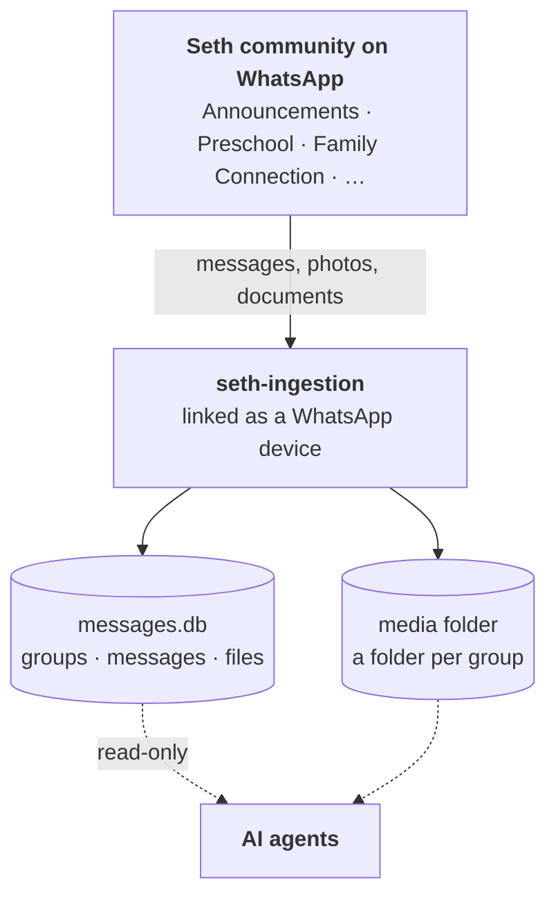
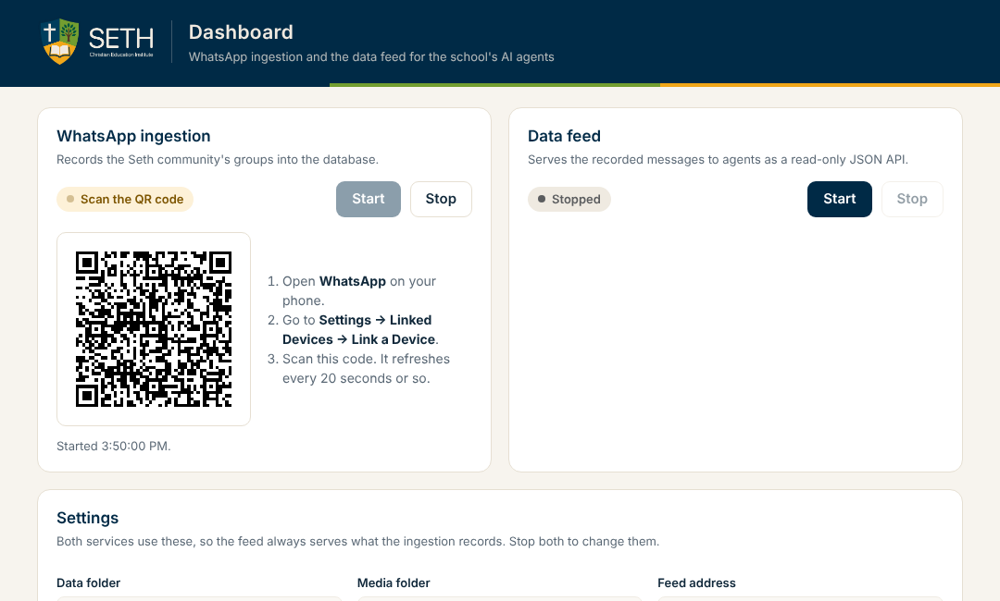
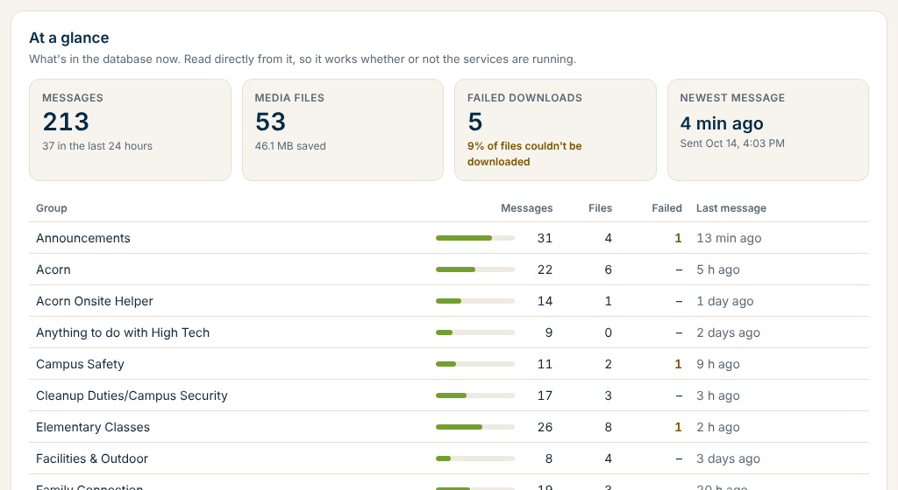

<p align="center">
  <picture>
    <source media="(prefers-color-scheme: dark)" srcset="docs/assets/seth-logo-dark.png">
    
  </picture>
</p>

<h1 align="center">seth-ingestion</h1>

<p align="center">
  <strong>The WhatsApp data feed for Seth Christian Education Institute.</strong><br>
  It collects what's shared in the Seth community's WhatsApp groups,<br>
  so the school's AI agents can read it and act on it.
</p>

<p align="center">
  
  
  
</p>

<p align="center">
  <a href="#quick-start">Quick start</a> ·
  <a href="#the-dashboard">Dashboard</a> ·
  <a href="#choosing-the-groups">Groups</a> ·
  <a href="#what-gets-recorded">What's recorded</a> ·
  <a href="#for-ai-agents">For AI agents</a> ·
  <a href="#configuration">Configuration</a> ·
  <a href="#troubleshooting">Troubleshooting</a> ·
  <a href="#documentation">Docs</a>
</p>

---

## How it works

Life at Seth runs on WhatsApp: announcements, class groups, volunteer schedules, campus duties. seth-ingestion is a small Go program that links to a WhatsApp account as a device, the same way WhatsApp Web does. From then on, it records what's shared in the community's groups.



What you get:

- 💬 **Every message** in the groups listed in [`groups.txt`](groups.txt), with its group, sender and time.
- 🖼️ **Photos, videos, voice notes and documents**, saved in a folder per group, such as `preschool/`.
- 🤖 **A steady feed for AI agents.** Rows are only ever added, never deleted, so an agent can follow along by remembering the last row it saw.

Everything stays on the machine running the program: a single SQLite file in `data/` and a media folder. No server or cloud service is involved.

## Quick start

**You'll need**

- A Mac with the Xcode command line tools (`xcode-select --install`), which the SQLite driver needs
- Go 1.26.1 or newer (`brew install go`)
- A phone with WhatsApp, signed in to an account that's a member of the Seth community

**Run it**

The easiest way is the [dashboard](#the-dashboard): run `./dashboard.sh`, and link WhatsApp and start everything from your browser.

To run it from a terminal instead:

```bash
./run.sh
```

The first run builds the program and shows a QR code in the terminal.

1. On your phone, open **WhatsApp → Settings → Linked Devices → Link a Device**.
2. Scan the QR code. It refreshes every 20 seconds or so; if it times out, run `./run.sh` again.
3. Once you see `Recording N groups: …`, it's working.

Later runs reuse the saved session, so there's nothing to scan. Press **Ctrl+C** to stop.

> [!NOTE]
> Right after you link the device, WhatsApp also sends some recent history. Messages from the listed groups found there are recorded too, with `source = 'history'`. Messages that arrive while the program runs are `'live'`.

## The dashboard

A control panel for this Mac, in your browser. From one page you can link WhatsApp by scanning the QR code, start and stop the ingestion and the data feed, and choose where the data lives.

```bash
./dashboard.sh
```

It builds itself the first time, then opens <http://127.0.0.1:8090>. Press **Ctrl+C** in the terminal to close it; that also stops both services.

<p align="center">
  
</p>

**Link WhatsApp and start recording**

1. Press **Start** under **WhatsApp ingestion**. The first time, a QR code appears on the page.
2. On your phone, open **WhatsApp → Settings → Linked Devices → Link a Device**, and scan it. The code refreshes every 20 seconds or so. If it expires, press **Start** again.
3. The status changes to **Linked**, then **Connected**, then **Recording 17 groups**.

Once the device is linked, later starts connect straight away, with no QR code.

**Serve the data to agents**

Press **Start** under **Data feed**. When it says **Serving**, agents can connect at the address shown, by default <http://127.0.0.1:8080>. The two services are independent: the feed can run while the ingestion is stopped, and serves whatever has been recorded.

**Settings**

| Setting | Default | Meaning |
|---|---|---|
| Data folder | `data` | Holds the message database (`messages.db`) and the linked WhatsApp session |
| Media folder | `/Users/tnpbot/Downloads/whatsapp-poc-images` | Where photos and other files are saved, in a folder per group |
| Feed address | `127.0.0.1:8080` | Where the data feed listens. `0.0.0.0:8080` opens it to your network, with no login |

### At a glance

Below the controls, the **At a glance** panel shows how the ingestion is doing: messages and media files saved, expired files and failed downloads, the newest message, and a per-group breakdown. It reads the database directly (read-only), so it works even when everything is stopped.

It also shows **storage**: how much disk the ingestion takes (the media folder plus the database and WhatsApp session) and how much space is left on this Mac, with a warning when free space runs low. Media piles up over time, so keep an eye on it. Sizes come from the files on disk and refresh every 30 seconds.

<p align="center">
  
</p>

Both services always use the same folders, so the feed serves exactly what the ingestion records. The settings can only be changed while both are stopped. Relative paths are relative to this repo, and the page shows the full path for each. The settings are saved in `dashboard.json`.

> [!NOTE]
> The dashboard only answers requests from this Mac, and other websites can't press its buttons. It runs `run.sh` and `feed.sh` for you, so everything else in this README still applies. The **Output** panel shows what each one prints.

## Choosing the groups

[`groups.txt`](groups.txt) lists the groups to record, one name per line, as WhatsApp shows them. Case and extra spaces don't matter, lines starting with `#` are ignored, and `Announcements` means the community's announcement group. Restart the program after editing it.

Only groups that are both listed **and** part of the Seth community are recorded. Everything else is ignored: other groups, direct chats, status updates and broadcast lists.

When it starts, the program tells you what it found:

| Log line | Meaning |
|---|---|
| `Recording N groups: …` | The groups it found and is recording |
| `Group "…" isn't one of your groups in the Seth community …` | A listed group it couldn't find, perhaps because it was renamed. Fix its name in `groups.txt` |
| `Not recording these groups in the Seth community …` | The community's other groups you're in. Add any you want to `groups.txt` |

## What gets recorded

The database has three tables:

| Table | One row per | Highlights |
|---|---|---|
| `chat_groups` | recorded group | its name, its community and its media folder |
| `messages` | message | the group (`chat_jid`), who sent it (`sender`), when (`sent_at`), what kind (`message_type`) and the text (`body`) |
| `message_media_files` | photo, video or other file | where it was saved (`relative_path`), its type, size and checksum |

How each kind of message is stored:

| When someone sends… | `messages` gets | `message_media_files` gets |
|---|---|---|
| A text, or a reply | a `text` row with the text in `body` | nothing |
| A photo, video, voice note, audio file, document or sticker | a row of that type, with any caption in `body` | one row for the file |
| Several photos or videos at once (an album) | **one** `album` row | one row per item, in order (`position`) |
| An edit to an earlier message | an `edit` row with the new text, pointing to the original (`edit_target_id`) | nothing |
| Anything else: reactions, locations, polls… | an `other` row, with everything in `raw_json` | nothing |

Your own messages are recorded the same way as everyone else's. `sender` shows each person as WhatsApp would: your saved contact name for them, otherwise their own display name, otherwise their phone number. Notices such as "… joined from the community" aren't recorded.

**Media folders.** Each group's files go in their own folder, named after the group in lowercase with dashes, such as `preschool/`, `cleanup-duties-campus-security/` or `preschool-pe-teachers/`. A group keeps its folder if it's renamed later. Files are named `<UTC time>_<message id>.<ext>`.

**A quick look at the data:**

```bash
sqlite3 -readonly -header -column data/messages.db \
  "SELECT m.sent_at, g.name AS grp, m.sender, m.message_type, m.body
   FROM messages m JOIN chat_groups g ON g.group_jid = m.chat_jid
   ORDER BY m.sent_at DESC LIMIT 20;"
```

[DATABASE.md](docs/DATABASE.md) describes every column and has more queries.

## For AI agents

The data is collected so that agents can use it, in one of two ways.

**Over HTTP, with `seth-feed`.** A read-only REST API with JSON responses, for agents on this computer or elsewhere:

```bash
./feed.sh                                             # serves on http://127.0.0.1:8080
curl "http://127.0.0.1:8080/messages/new?since=0"     # everything so far, plus a cursor
curl "http://127.0.0.1:8080/messages/new?since=250.80"  # only what's new since that cursor
```

An agent calls `/messages/new` every few seconds with the `cursor` from its last call, and gets each new message exactly once, with edits applied and album photos complete. See [HTTP API](docs/CONSUMING.md#http-api) for every endpoint.

**Directly from SQLite.** A program on the same computer can open the database read-only, alongside the running program, and poll for rows it hasn't seen yet:

```python
import sqlite3

db = sqlite3.connect("file:data/messages.db?mode=ro", uri=True)
last_seen = 0  # the highest rowid handled so far
new = db.execute("""
    SELECT m.rowid, g.name, m.sender, m.message_type, m.body
    FROM messages m JOIN chat_groups g ON g.group_jid = m.chat_jid
    WHERE m.rowid > ? ORDER BY m.rowid""", (last_seen,)).fetchall()
```

> [!TIP]
> No real messages needed to get started. `./sim.sh seed` fills `data-sim/` with a week of invented Seth group traffic, and `./sim.sh live` keeps adding to it, in exactly the same format. See [Testing with simulated data](docs/CONSUMING.md#testing-with-simulated-data).

**[CONSUMING.md](docs/CONSUMING.md)** is the guide for building agents. It covers following new messages and files, reading conversations with edits and replies, finding media files, what the data guarantees, and a complete working example.

## Configuration

The defaults match the setup above. To change them, pass flags to `./run.sh` (see `./run.sh -h`) or set environment variables:

| Flag | Variable | Default |
|---|---|---|
| `-community` | `SETH_COMMUNITY` | `Seth`. The community's name, or its group JID if several communities share the name |
| `-groups-file` | `SETH_GROUPS_FILE` | `groups.txt` |
| `-media-dir` | `SETH_MEDIA_DIR` | `/Users/tnpbot/Downloads/whatsapp-poc-images` |
| `-data-dir` | `SETH_DATA_DIR` | `./data`, for the message database and the WhatsApp session |
| `-log-level` | `SETH_LOG_LEVEL` | `INFO`. Also `DEBUG`, `WARN` or `ERROR` |

## Day to day

- **Unlinking.** If you remove the device under **Linked Devices** on your phone while the program runs, it logs `This device was unlinked from WhatsApp` and shows a new QR code. Scan it to link again, or press Ctrl+C. The next `./run.sh` starts with a QR code too.
- **Starting fresh.** To clear the recorded data, delete `data/messages.db` and the media folder.
- **Upgrading from the single-contact version.** Earlier versions recorded one contact's direct messages. Those rows are kept (`is_group = 0`, with no `chat_groups` row), and their files stay at the top of the media folder.

## Troubleshooting

<details>
<summary><strong>A group isn't being recorded</strong></summary>

Check the startup log. A listed group that wasn't found gets a warning; compare its name in `groups.txt` with WhatsApp. Groups are matched by name when the program starts, so when a group is renamed, update `groups.txt` before the next start. A rename while the program is running is picked up, and the group keeps its media folder.
</details>

<details>
<summary><strong><code>you're not in a community named "Seth"</code></strong></summary>

The error lists the communities that were found. Pass the right name with `-community`.
</details>

<details>
<summary><strong><code>Failed to download …</code></strong></summary>

WhatsApp keeps media on its servers for a limited time, so files in older history may have expired (WhatsApp answers `status code 403`, `404` or `410`). The message and its file row are still saved, with the reason in the file row's `error` column. The dashboard counts these as **expired**, not failed; **Failed** is left for other problems, such as a full disk.
</details>

<details>
<summary><strong>A sender has no phone number</strong></summary>

Newer WhatsApp groups can identify people by a hidden ID instead of their phone number. The program translates these IDs back to phone numbers where WhatsApp has shared the mapping, and always keeps the ID in `sender_jid`. Run with `-log-level DEBUG` to see what arrives.
</details>

## Documentation

| Guide | Read it to… |
|---|---|
| [CONSUMING.md](docs/CONSUMING.md) | build an AI agent or other program that reads the data, over the HTTP API or from SQLite, and test it with simulated messages |
| [DATABASE.md](docs/DATABASE.md) | look up a table or column, or see how albums, edits and upgrades work |
| [DEVELOPMENT.md](docs/DEVELOPMENT.md) | understand how the programs work (ingestion, feed, simulator, dashboard), change them, and test them |

---

<p align="center">
  <br>
  <sub>Made for the Seth community. Built on <a href="https://github.com/tulir/whatsmeow">whatsmeow</a>, an unofficial WhatsApp client.</sub>
</p>
