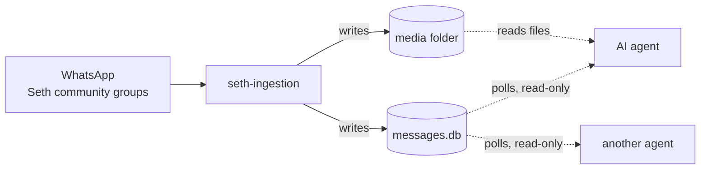

# Consuming the data

seth-ingestion collects the Seth community's WhatsApp messages so that other programs can use them, above all the school's AI agents. This guide is for whoever builds those agents. It covers how to read the data safely, how to follow new messages as they arrive, and what you can rely on.

For what each column means, see [DATABASE.md](DATABASE.md). For how the data is collected, see the [README](../README.md).

**On this page:** [At a glance](#at-a-glance) · [Connecting](#connecting) · [Following new messages](#following-new-messages) · [Reading a conversation](#reading-a-conversation) · [Media files](#media-files) · [What you can rely on](#what-you-can-rely-on) · [Testing with simulated data](#testing-with-simulated-data) · [A complete example](#a-complete-example)

## At a glance

- **Where:** `data/messages.db`, a SQLite database, and the media folder (by default `/Users/tnpbot/Downloads/whatsapp-poc-images`).
- **What:** every message in the [listed groups](../groups.txt) of the Seth community, with its group, sender and files.
- **Access:** read-only. Any number of readers can run while seth-ingestion is writing.
- **Freshness:** a live text message is in the database moments after it's sent. A message with a photo or file appears once the file has downloaded.
- **Delivery:** pull. There's no push or webhook: agents poll for rows newer than the last ones they saw.



## Connecting

Open the database **read-only**. seth-ingestion is the only writer, and a read-only connection guarantees an agent can't change or lock the data by mistake.

```python
import sqlite3

db = sqlite3.connect("file:data/messages.db?mode=ro", uri=True)
db.row_factory = sqlite3.Row
```

From a terminal:

```bash
sqlite3 -readonly -header -column data/messages.db "SELECT name, media_folder FROM chat_groups;"
```

The database runs in WAL mode, so readers never wait for the writer, and the writer never waits for readers. Each query sees the latest committed data. A message and its first files are committed together, so you never see a file whose message isn't there yet.

> [!TIP]
> Keep transactions short. A reader that holds a transaction open for hours stops SQLite from tidying up its write-ahead log, which then keeps growing.

## Following new messages

To follow new data, an agent keeps two cursors and polls with them every few seconds:

| Table | Cursor | Grows when |
|---|---|---|
| `messages` | `rowid` | a new message is recorded |
| `message_media_files` | `id` | a new file is recorded, including each photo of an album |

Both numbers only ever increase, because seth-ingestion never deletes rows. Remember the highest value you've handled, and on the next poll ask for anything above it:

```sql
-- New messages, oldest first. :last_message is the highest rowid already handled (0 to start).
SELECT m.rowid AS seq, g.name AS grp, m.sender, m.message_type, m.body, m.sent_at, m.quoted_id
FROM messages m
JOIN chat_groups g ON g.group_jid = m.chat_jid
WHERE m.rowid > :last_message
ORDER BY m.rowid;

-- New files. :last_file is the highest id already handled.
SELECT f.id, f.chat_jid, f.message_id, f.position, f.media_type, f.relative_path, f.error
FROM message_media_files f
WHERE f.id > :last_file
ORDER BY f.id;
```

Store both cursors somewhere durable, such as a small file or your agent's own database, so a restarted agent carries on where it stopped.

> [!IMPORTANT]
> Follow both tables. An album appears in `messages` as soon as its first photo arrives. Its other photos arrive later, each as a new row in `message_media_files` under the same message. An agent that only follows `messages` sees the first photo and misses the rest.

A few things to know when following:

- **Order of arrival isn't the order of sending.** Rows appear in the order seth-ingestion received them. Right after the device is linked, WhatsApp sends recent history, so older messages (`source = 'history'`) can arrive after newer live ones. Use `sent_at` when you need the conversation in order.
- **Some values are filled in later.** An album's caption (`body`), its `raw_json`, its earliest `sent_at` and its `media_file_count` can be completed after the row first appears. If that matters to you, re-read a message by its key when you see a new file for it. Nothing else in a message row changes.
- **Don't use `ingested_at` as a cursor.** It has one-second precision, so several rows share each value.

## Reading a conversation

To read one group's conversation in order, with each message's latest edit applied and replies resolved:

```sql
SELECT datetime(m.sent_at, 'localtime') AS sent,
       m.sender,
       m.message_type,
       COALESCE((SELECT e.body FROM messages e
                 WHERE e.chat_jid = m.chat_jid AND e.message_type = 'edit' AND e.edit_target_id = m.message_id
                 ORDER BY e.sent_at DESC LIMIT 1), m.body) AS body,
       q.sender AS reply_to,
       m.media_file_count AS files
FROM messages m
JOIN chat_groups g ON g.group_jid = m.chat_jid
LEFT JOIN messages q ON q.chat_jid = m.chat_jid AND q.message_id = m.quoted_id
WHERE g.name = 'Preschool' AND m.message_type <> 'edit'
ORDER BY m.sent_at;
```

Everything from the last 24 hours, across all groups:

```sql
SELECT g.name AS grp, m.sent_at, m.sender, m.message_type, m.body
FROM messages m
JOIN chat_groups g ON g.group_jid = m.chat_jid
WHERE m.sent_at >= strftime('%Y-%m-%dT%H:%M:%SZ', 'now', '-1 day')
ORDER BY m.sent_at;
```

What the rows mean:

| You see | It means |
|---|---|
| `message_type = 'text'` | A text message. The text is in `body` |
| `image`, `video`, `voice`, `audio`, `document`, `sticker` | A message with one file. Any caption is in `body` |
| `album` | Several photos or videos sent together: one message, one file row per item, ordered by `position` |
| `edit` | A change to an earlier message. `body` is the new text, `edit_target_id` the message it changes. The original row is left as it was |
| `other` | A reaction, location, poll, contact card and so on. The details are only in `raw_json` |
| `quoted_id` is set | The message replies to the message with that `message_id` in the same group |

**Who sent it.** `sender` is a display name: your saved contact name for the person, or the name they set themselves. It can differ between messages. To tell people apart, use `sender_phone` where it's set, or else `sender_jid`.

**Which group.** Use `chat_groups.group_jid` (the same value as `messages.chat_jid`) to identify a group. Names can change; IDs don't. The announcement group is always named `Announcements`.

**Times** are UTC, written like `2026-10-14T16:00:00Z`. They sort correctly as text, and `datetime(sent_at, 'localtime')` converts them.

## Media files

A file's full path is the media folder joined with its `relative_path`:

```python
from pathlib import Path

MEDIA_DIR = Path("/Users/tnpbot/Downloads/whatsapp-poc-images")
path = MEDIA_DIR / row["relative_path"]   # e.g. …/preschool/20261014T160400Z_3A37298F72373DFA1114.jpg
```

- Each group's files are in its own folder, such as `preschool/` or `cleanup-duties-campus-security/`. `chat_groups.media_folder` gives each group's folder.
- `mime` gives the file type, for example `image/jpeg` or `audio/ogg; codecs=opus`. Documents keep their original name in `file_name`.
- If a download failed, `relative_path` is `NULL` and `error` says why. This mostly happens to older history, whose files WhatsApp no longer keeps. These files aren't downloaded again.
- `sha256` identifies the file's content. The same photo forwarded to two groups has the same value.

## What you can rely on

These hold for every version, and changes to them will be called out:

- **Rows are never deleted.** Messages and files only get added. In a message row, only the album details listed in [Following new messages](#following-new-messages) are ever filled in later. A `chat_groups` row gets a new `name` when the group is renamed.
- **Keys don't change.** A message is identified by `chat_jid` + `message_id`, a file by `id`, and a group by `group_jid`.
- **Only the listed groups are recorded.** There are no direct chats, status updates or broadcast lists. Rows from an earlier version of seth-ingestion, which recorded one contact's direct messages, have `is_group = 0` and no `chat_groups` row; the joins above leave them out.
- **The schema only grows.** New columns and tables may be added. Name the columns you select, rather than relying on `SELECT *` and column positions.

> [!CAUTION]
> These are a school community's private conversations, with parents' names and phone numbers and photos of children. Give agents only the access they need, keep the data on machines you control, and don't send it to services the school hasn't agreed to.

## Testing with simulated data

You don't need real WhatsApp messages to build or test an agent. `seth-sim` writes invented Seth group traffic into its own database and media folder, `data-sim/`, through the same code that writes the real database. The tables, the row shapes and the way rows appear (albums arriving photo by photo, edits, failed downloads) are all the same.

```bash
./sim.sh seed      # a week of history across all the listed groups
./sim.sh live      # a new message every few seconds, until Ctrl+C
./sim.sh send -group Preschool -from "Melissa Chen" -text "Pickup moved to 3:30 today"
```

Then point your agent at `data-sim/messages.db` and `data-sim/media` instead of the real paths. Run `./sim.sh live` in one terminal and your agent in another to watch it follow messages as they arrive.

| Command | What it does | Useful flags |
|---|---|---|
| `seed` | Adds history, `source = 'history'`, spread over school hours | `-days` (7), `-per-day` (25) |
| `live` | Adds messages as they "arrive", `source = 'live'` | `-interval` (5s), `-count` (0 = until Ctrl+C) |
| `send` | Adds one message you describe | `-group`, `-from`, `-text`, `-kind`, `-target` |

All commands also take `-db`, `-media-dir`, `-groups-file` and `-seed`. Run `./sim.sh <command> -h` for details.

**What you get.** Texts, replies, edits, photos, albums of 2 to 4 photos, PDF documents, voice notes, reactions (`other` rows) and downloads that failed, in every group in `groups.txt`. Announcements come from staff only. Some senders have no phone number, as happens in real groups. `send -kind` picks one of `text`, `reply`, `edit`, `image`, `album`, `document`, `voice`, `reaction` or `failed`; `-target` chooses the message a reply, edit or reaction points at.

### School events, for calendar agents

Announcements make up about one message in eight, and most of them are about school events, the way a school office writes them:

- **New events:** "📅 The fall family picnic is on Sat, Oct 24 at 11am. Bring a dish to share!"
- **Reminders** for the next few days: "Reminder: school picture day is tomorrow."
- **Deadlines:** "Permission slips for the field trip to the pumpkin patch on 10/27 are due by Friday, October 23."
- **Reschedules:** "Update: chapel with a guest speaker has been moved from Oct 21 to Nov 4 at 9am."
- **Cancellations:** "The bake sale fundraiser on Friday, October 23 is cancelled because of low sign-ups."
- **Corrections** by editing an earlier post: an `edit` row saying "Correction: parent-teacher conferences are now Fri, Oct 30 to 10/31."
- **Multi-day events,** such as the book fair or Thanksgiving break.

Dates are written in mixed formats, relative to when the message was sent: "tomorrow", "this Friday", "Monday, October 19", "Mon, Oct 19", "10/19", "Oct 19" and "Monday 10/19/2026". Times are written as "11am", "6:30pm" or "6:30 PM". Seasonal events stay in season: the pumpkin patch is in October, the Christmas program in December, and Thanksgiving break in Thanksgiving week.

**Checking your agent's answers.** Each event post also has a row in `simulated_events`, which exists only in simulated databases. It records what the post really means, so a test can compare what your agent extracted with what was announced:

| Column | Meaning |
|---|---|
| `chat_jid`, `message_id` | The post (or edit) that announced it |
| `event` | Which event, e.g. `fall family picnic` |
| `action` | `scheduled`, `reminder`, `deadline`, `rescheduled` or `cancelled` |
| `starts_at` | When it starts, in the school's local time: `2026-10-24T11:00:00-07:00`, or a date like `2026-10-24` for an all-day event |
| `ends_on` | The last day of a multi-day event |
| `all_day` | `1` for an all-day event |
| `previous_starts_at` | For `rescheduled`: the date it moved from |
| `deadline_on` | For `deadline`: the day the permission slips are due |

```sql
SELECT m.sent_at, m.body, e.action, e.starts_at, e.previous_starts_at, e.deadline_on
FROM simulated_events e
JOIN messages m USING (chat_jid, message_id)
ORDER BY m.rowid;
```

**Things to know**

- **It's all invented.** People, phone numbers (in the 555-01xx range, which is reserved for fiction), group IDs and messages are made up. The group IDs differ from the real ones, so don't hard-code them.
- **Repeatable.** The same `-seed` gives the same messages, which helps when a test needs fixed data.
- **Photos and PDFs are real files.** Voice notes are not: each is a short text placeholder with an audio file name, so code that decodes audio will fail on them.
- **Telling it apart.** A simulated database has an extra `simulation` table, which a real one never has. seth-sim refuses to write to a database that sits next to a WhatsApp session or holds messages it didn't make, so it can't touch the real data.
- **Starting over.** Each run adds to what's there. To start fresh, delete `data-sim/`.

## A complete example

A small Python agent that follows every listed group and prints new messages and files as they arrive:

```python
import sqlite3
import time
from pathlib import Path

DB = "data/messages.db"
MEDIA_DIR = Path("/Users/tnpbot/Downloads/whatsapp-poc-images")

db = sqlite3.connect(f"file:{DB}?mode=ro", uri=True)
db.row_factory = sqlite3.Row

last_message = last_file = 0  # save these somewhere to resume after a restart

while True:
    for m in db.execute("""
            SELECT m.rowid AS seq, g.name AS grp, m.sender, m.message_type, m.body
            FROM messages m JOIN chat_groups g ON g.group_jid = m.chat_jid
            WHERE m.rowid > ? ORDER BY m.rowid""", (last_message,)).fetchall():
        print(f"[{m['grp']}] {m['sender']}: {m['body'] or '(' + m['message_type'] + ')'}")
        last_message = m["seq"]

    for f in db.execute("""
            SELECT id, media_type, relative_path, error
            FROM message_media_files WHERE id > ? ORDER BY id""", (last_file,)).fetchall():
        print(f"  {f['media_type']}:", MEDIA_DIR / f["relative_path"] if f["relative_path"] else f["error"])
        last_file = f["id"]

    time.sleep(5)
```

In a real agent, replace the `print` calls with your own handling, and save `last_message` and `last_file` after each batch.
