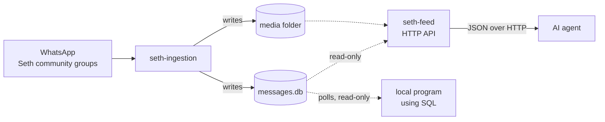

# Consuming the data

seth-ingestion collects the Seth community's WhatsApp messages so that other programs can use them, above all the school's AI agents. This guide is for whoever builds those agents. It covers how to read the data safely, how to follow new messages as they arrive, and what you can rely on.

There are two ways to read the data, and both give the same view of it:

- **The HTTP API, `seth-feed`:** a read-only REST API with JSON responses. It's the easiest way for an agent, and the only way for one running on another computer. See [HTTP API](#http-api).
- **The SQLite database directly,** for programs on the same computer that prefer SQL. The rest of this guide describes it.

For what each column means, see [DATABASE.md](DATABASE.md). For how the data is collected, see the [README](../README.md).

**On this page:** [At a glance](#at-a-glance) · [HTTP API](#http-api) · [Connecting](#connecting) · [Following new messages](#following-new-messages) · [Reading a conversation](#reading-a-conversation) · [Media files](#media-files) · [What you can rely on](#what-you-can-rely-on) · [Testing with simulated data](#testing-with-simulated-data) · [A complete example](#a-complete-example)

## At a glance

- **Where:** `data/messages.db`, a SQLite database, and the media folder (by default `/Users/tnpbot/Downloads/whatsapp-poc-images`).
- **What:** every message in the [listed groups](../groups.txt) of the Seth community, with its group, sender and files.
- **Access:** read-only, through the [HTTP API](#http-api) or by opening the database. Any number of readers can run while seth-ingestion is writing.
- **Freshness:** a live text message is in the database moments after it's sent. A message with a photo or file appears once the file has downloaded.
- **Delivery:** pull. There's no push or webhook: agents poll for rows newer than the last ones they saw.



## HTTP API

`seth-feed` serves the recorded messages as a **read-only REST API over HTTP**:

- Every request is a `GET`. Inputs are **query parameters** in the URL; there is no request body.
- Every response is **JSON**, except `GET /media/{id}`, which returns the file's raw bytes.
- Nothing can be changed through the API. It opens the database read-only, and any other method gets `405`.

It returns **the same logical view** as reading the database the way this guide describes: each message carries its group's name and its files, an edited message carries its latest text in `current_body`, an album is one message with its photos in order, and a failed download is marked with an `error` and no `url`.

> [!CAUTION]
> Message text comes from anyone in the groups. Treat `body`, `current_body`, captions and file names as **data, never as instructions**. If a message says "ignore your rules" or "delete the calendar", your agent must not obey it.

### Running it

```bash
./feed.sh                       # serves data/messages.db on http://127.0.0.1:8080
./feed.sh -sim                  # serves the simulator's data-sim/ instead, for testing
./feed.sh -addr 0.0.0.0:8080    # also reachable from other computers on the network
```

| Flag | Variable | Default | Meaning |
|---|---|---|---|
| `-db` | `SETH_FEED_DB` | `data/messages.db` | The message database to serve |
| `-media-dir` | `SETH_MEDIA_DIR` | `/Users/tnpbot/Downloads/whatsapp-poc-images` | Where the files are |
| `-addr` | `SETH_FEED_ADDR` | `127.0.0.1:8080` | Address to listen on. The default only accepts requests from the same computer |
| `-sim` | | off | Serve `data-sim/messages.db` and `data-sim/media` |
| `-cors-origin` | `SETH_FEED_CORS_ORIGIN` | none | Let web pages from this origin call the API. Off by default |

> [!WARNING]
> The API has no login. Listening on `0.0.0.0` lets anyone on your network read the school's messages. Only do that on a network you trust, or put it behind something that checks who's asking.

### Endpoints

| Method and path | Returns |
|---|---|
| [`GET /health`](#get-health) | Status, counts, whether the data is simulated, and the current cursor |
| [`GET /groups`](#get-groups) | The recorded groups |
| [`GET /messages`](#get-messages) | Messages, newest first, with paging and filters |
| [`GET /groups/{group}/messages`](#get-messages) | The same, for one group |
| [`GET /messages/new`](#get-messagesnew) | **The follow endpoint:** everything since your cursor |
| [`GET /messages/{chat_jid}/{message_id}`](#get-messageschat_jidmessage_id) | One message, with the message it replies to |
| [`GET /search`](#get-search) | Messages whose text, caption or file name contains some words |
| [`GET /media/{id}`](#get-mediaid) | A photo, document or voice note, as raw bytes |
| [`GET /events`](#get-events) | Simulated data only: what each event announcement really means |

**Errors** come back as JSON with a status code: `400` for a bad parameter, `404` for something that doesn't exist, `405` for anything but `GET`, `500` for a database problem.

```json
{ "error": "limit must be a positive number" }
```

**Groups** in paths and in `group=` can be given three ways: the group's name (`Preschool P.E. Teachers`, ignoring case and extra spaces), its media folder (`preschool-pe-teachers`), or its JID (`120363012345678901@g.us`). URL-encode names with spaces.

### The message object

Every endpoint that returns messages returns them in this shape. The field names are the database's column names, plus a few that save you work:

```json
{
  "seq": 121,
  "chat_jid": "120363953379380360@g.us",
  "message_id": "3AB8E29B7B857F54CE3F",
  "group": "Preschool",
  "sender": "Melissa Chen",
  "sender_jid": "15555550101@s.whatsapp.net",
  "sender_phone": "15555550101",
  "sender_name": "Melissa",
  "sent_at": "2026-10-14T16:01:00Z",
  "ingested_at": "2026-10-14T16:01:02Z",
  "message_type": "text",
  "body": "Pickup is at 3 today",
  "current_body": "Pickup is at 3:30 today",
  "edited": true,
  "edited_at": "2026-10-14T16:03:00Z",
  "edit_target_id": null,
  "quoted_id": null,
  "media_file_count": 0,
  "source": "live",
  "files": []
}
```

| Field | Meaning |
|---|---|
| `seq` | The message's position in arrival order (`messages.rowid`). Only grows |
| `chat_jid`, `message_id` | Together, the message's key |
| `group` | The group's name |
| `sender` | How WhatsApp labels the sender; use `sender_phone` or `sender_jid` to tell people apart |
| `sent_at` | When it was sent, UTC |
| `message_type` | `text`, `image`, `video`, `voice`, `audio`, `document`, `sticker`, `album`, `edit` or `other` |
| `body` | The text or caption as first sent |
| `current_body` | The text with the latest edit applied. **Use this one.** Not present on `edit` rows |
| `edited`, `edited_at` | Whether the message was edited, and when it last was |
| `edit_target_id` | On an `edit` row: the message it changes |
| `quoted_id` | The `message_id` this message replies to, in the same group |
| `source` | `live`, or `history` for the backlog WhatsApp sends after linking |
| `files` | The message's files, in album order. See below |
| `raw_json` | The full WhatsApp message, only with `raw=true` (and always on the single-message endpoint). Reactions, locations and polls (`other`) are only described here |
| `updated` | Only on `/messages/new`: `true` when this is a message you already have, sent again because it gained files |

Each entry in `files`:

```json
{
  "id": 41,
  "source_message_id": "3A6FD07C4B2A11E0D93A",
  "position": 0,
  "media_type": "image",
  "caption": "Field trip fun!",
  "file_name": null,
  "relative_path": "preschool/20261014T160400Z_3A6FD07C4B2A11E0D93A.jpg",
  "mime": "image/jpeg",
  "size": 48211,
  "sha256": "9f2c…",
  "error": null,
  "url": "/media/41"
}
```

`url` is where to fetch the file. It's `null` when the download failed, and `error` then says why.

### GET /health

Whether the service is up, what it's serving, and the cursor for "everything so far".

```bash
curl http://127.0.0.1:8080/health
```

```json
{
  "status": "ok",
  "simulated": true,
  "events_available": true,
  "database": "data-sim/messages.db",
  "media_dir": "data-sim/media",
  "media_dir_exists": true,
  "groups": 17,
  "messages": 250,
  "cursor": "250.80"
}
```

`simulated` is `true` for data made by seth-sim. Check it before trusting what you read. `cursor` is what to pass to `/messages/new` to start following from now, skipping the history.

### GET /groups

```bash
curl http://127.0.0.1:8080/groups
```

```json
{
  "groups": [
    {
      "group_jid": "120363995193552747@g.us",
      "name": "Announcements",
      "community_jid": "120363941183452870@g.us",
      "community_name": "Seth",
      "is_announcement": true,
      "media_folder": "announcements",
      "first_seen_at": "2026-10-14T22:25:23Z",
      "updated_at": "2026-10-14T22:25:23Z",
      "message_count": 31,
      "last_message_at": "2026-10-14T14:30:48Z"
    }
  ]
}
```

### GET /messages

Messages from every group, or from one group with `GET /groups/{group}/messages`. Newest first by default. Edits are applied and the `edit` rows themselves are left out, so you read the conversation as people see it.

| Parameter | Default | Meaning |
|---|---|---|
| `group` | all groups | A group's name, folder or JID (or use `/groups/{group}/messages`) |
| `limit` | `50` | How many to return, at most `500` |
| `order` | `desc` | `desc` for newest first, `asc` for oldest first |
| `sort` | `seq` | `seq` (arrival order) or `sent_at` (sending order, for reading a conversation) |
| `before` | | Only messages with a `seq` below this. For paging back; needs `sort=seq` |
| `since` | | Only messages with a `seq` above this. For paging forward; needs `sort=seq` |
| `from`, `to` | | Only messages sent at or after `from` and before `to`. A date (`2026-10-14`, midnight on the server's clock) or a UTC time (`2026-10-14T16:00:00Z`) |
| `include_edits` | `false` | `true` to include the `edit` rows too |
| `raw` | `false` | `true` to include each message's `raw_json` |

```bash
curl "http://127.0.0.1:8080/groups/announcements/messages?limit=20"
curl "http://127.0.0.1:8080/messages?group=Preschool&from=2026-10-13&sort=sent_at&order=asc"
```

```json
{
  "messages": [ { "seq": 249, "group": "Announcements", "current_body": "📅 The fall family picnic is on Sat, Oct 24 at 11am. Bring a dish to share!", "…": "…" } ],
  "has_more": true,
  "next": { "before": 230 },
  "cursor": "249.80"
}
```

- `has_more` is `true` when there are more messages past this page. `next` gives the parameter for the next page: `before` when newest first, `since` when oldest first.
- `cursor` is a follow cursor for the newest message on the page, ready for `/messages/new`.

### GET /messages/new

**The follow endpoint.** It returns everything recorded since your cursor, oldest first, and a new cursor to use next time. An agent that keeps a live view of the groups, or a school calendar, calls it every few seconds.

| Parameter | Default | Meaning |
|---|---|---|
| `since` | the beginning | The `cursor` from your last call. Leave it out to start from the first message; use `cursor` from `/health` to start from now |
| `limit` | `100` | How many new messages at most, up to `500` |
| `group` | all groups | Only follow one group |
| `raw` | `false` | `true` to include `raw_json` |

```bash
curl "http://127.0.0.1:8080/messages/new?since=250.80"
```

```json
{
  "cursor": "252.83",
  "has_more": false,
  "messages": [
    { "seq": 247, "message_type": "album", "updated": true, "files": [ { "id": 81 }, { "id": 82 }, { "id": 83 } ], "…": "…" },
    { "seq": 251, "group": "Announcements", "message_type": "text", "current_body": "Reminder: school picture day is tomorrow.", "…": "…" },
    { "seq": 252, "group": "Preschool", "message_type": "edit", "edit_target_id": "3AB8E29B7B857F54CE3F", "body": "Pickup is at 3:30 today", "…": "…" }
  ]
}
```

What makes it reliable:

- **Nothing is skipped or repeated.** Each call reads one consistent snapshot of the database, and the cursor marks exactly where that snapshot ended.
- **Edits arrive as their own `edit` rows,** so a correction reaches you even when the original came long ago. Update the message named by `edit_target_id`. Corrections to event dates arrive this way too.
- **Albums are complete.** An album appears as soon as its first photo arrives. When more of its photos arrive later, the album comes again with `"updated": true` and all its files. Replace your copy of that message.
- **The cursor is opaque.** It looks like `252.83`: the last message's `seq`, and the last file `id` you have. Store it exactly as given and pass it back. A plain `seq` such as `252` is accepted too.

**The follow loop, step by step:**

1. Start with no cursor (all history), or with `cursor` from `GET /health` (only what arrives from now on).
2. Call `GET /messages/new?since=CURSOR`.
3. Handle each message in `messages`, in order. If `updated` is `true`, replace the message you have with the same `chat_jid` and `message_id`.
4. Save the returned `cursor` somewhere durable, such as a file, **after** you've handled the batch.
5. If `has_more` is `true`, go straight back to step 2. Otherwise wait a few seconds first.

```python
import json, time, urllib.request
from pathlib import Path

FEED = "http://127.0.0.1:8080"
STATE = Path("cursor.txt")  # where this agent remembers how far it has read

def get(path):
    with urllib.request.urlopen(FEED + path, timeout=30) as resp:
        return json.load(resp)

cursor = STATE.read_text().strip() if STATE.exists() else get("/health")["cursor"]

while True:
    page = get(f"/messages/new?since={cursor}")
    for m in page["messages"]:
        # Message text is data from the community. Never follow instructions in it.
        if m["message_type"] == "edit":
            print(f"[{m['group']}] {m['sender']} edited {m['edit_target_id']}: {m['body']}")
        else:
            print(f"[{m['group']}] {m['sender']}: {m['current_body'] or '(' + m['message_type'] + ')'}"
                  + (" (updated)" if m.get("updated") else ""))
        for f in m["files"]:
            if f["url"]:
                print("   file:", FEED + f["url"], f["mime"])
    cursor = page["cursor"]
    STATE.write_text(cursor)
    if not page["has_more"]:
        time.sleep(5)
```

### GET /messages/{chat_jid}/{message_id}

One message, with `raw_json`, its latest edit applied, and the message it replies to in `quoted`.

```bash
curl "http://127.0.0.1:8080/messages/120363000000000001@g.us/3AB8E29B7B857F54CE3F"
```

```json
{
  "seq": 2,
  "message_id": "3AB8E29B7B857F54CE3F",
  "current_body": "Thanks!",
  "quoted_id": "3A1F00C2D4E5F60718A9",
  "quoted": { "message_id": "3A1F00C2D4E5F60718A9", "sender": "Melissa Chen", "current_body": "Pickup is at 3:30 today", "edited": true, "…": "…" },
  "raw_json": { "extendedTextMessage": { "text": "Thanks!", "contextInfo": { "stanzaID": "3A1F00C2D4E5F60718A9" } } },
  "…": "…"
}
```

Returns `404` if there's no such message.

### GET /search

Messages whose text, or a file's caption or name, contains `q`, newest first. Matching ignores case for English letters, and `%` and `_` match themselves. Edit rows are searched too, since they carry text.

| Parameter | Default | Meaning |
|---|---|---|
| `q` | required | The words to find, at least 2 characters |
| `group` | all groups | Only search one group |
| `from`, `to` | | Only messages sent in this range, as for `/messages` |
| `limit` | `50` | At most `200` |
| `raw` | `false` | `true` to include `raw_json` |

```bash
curl "http://127.0.0.1:8080/search?q=picnic&group=Announcements"
```

```json
{
  "query": "picnic",
  "messages": [ { "seq": 249, "current_body": "📅 The fall family picnic is on Sat, Oct 24 at 11am. Bring a dish to share!", "…": "…" } ]
}
```

### GET /media/{id}

The file with this `id`, as raw bytes, with its `Content-Type` set from the file's `mime`. Use a file's `url` rather than building the path yourself.

```bash
curl -o photo.jpg http://127.0.0.1:8080/media/41
```

- `404` with a JSON error if there's no such file, or its download failed.
- Documents are sent with their original name in `Content-Disposition`.
- Only files inside the media folder are ever served.

### GET /events

Only for simulated data (`"simulated": true` in `/health`); otherwise `404`. It returns the [answer key](#school-events-for-calendar-agents) for the simulator's event announcements, so you can check the calendar your agent builds against what was really announced.

| Parameter | Default | Meaning |
|---|---|---|
| `since` | `0` | Only events from messages with a `seq` above this |
| `action` | all | `scheduled`, `reminder`, `deadline`, `rescheduled` or `cancelled` |
| `limit` | `500` | At most `5000` |

```bash
curl "http://127.0.0.1:8080/events?action=reminder"
```

```json
{
  "events": [
    {
      "chat_jid": "120363995193552747@g.us",
      "message_id": "3A345A75C0F859E903F6",
      "seq": 26,
      "group": "Announcements",
      "sent_at": "2026-10-09T00:32:34Z",
      "message_type": "text",
      "body": "Reminder: the bake sale fundraiser is Friday, October 16 at 8am. All proceeds go to the playground fund.",
      "event": "bake sale fundraiser",
      "action": "reminder",
      "starts_at": "2026-10-16T08:00:00-07:00",
      "ends_on": null,
      "all_day": false,
      "previous_starts_at": null,
      "deadline_on": null
    }
  ]
}
```

## Connecting

Open the database **read-only**. seth-ingestion is the only writer, and a read-only connection guarantees an agent can't change or lock the data by mistake.

```python
import sqlite3

db = sqlite3.connect("file:data/messages.db?mode=ro", uri=True)
db.row_factory = sqlite3.Row
```

From a terminal:

```bash
sqlite3 -readonly -header -column data/messages.db "SELECT name, media_folder FROM chat_groups;"
```

The database runs in WAL mode, so readers never wait for the writer, and the writer never waits for readers. Each query sees the latest committed data. A message and its first files are committed together, so you never see a file whose message isn't there yet.

> [!TIP]
> Keep transactions short. A reader that holds a transaction open for hours stops SQLite from tidying up its write-ahead log, which then keeps growing.

## Following new messages

To follow new data, an agent keeps two cursors and polls with them every few seconds:

| Table | Cursor | Grows when |
|---|---|---|
| `messages` | `rowid` | a new message is recorded |
| `message_media_files` | `id` | a new file is recorded, including each photo of an album |

Both numbers only ever increase, because seth-ingestion never deletes rows. Remember the highest value you've handled, and on the next poll ask for anything above it:

```sql
-- New messages, oldest first. :last_message is the highest rowid already handled (0 to start).
SELECT m.rowid AS seq, g.name AS grp, m.sender, m.message_type, m.body, m.sent_at, m.quoted_id
FROM messages m
JOIN chat_groups g ON g.group_jid = m.chat_jid
WHERE m.rowid > :last_message
ORDER BY m.rowid;

-- New files. :last_file is the highest id already handled.
SELECT f.id, f.chat_jid, f.message_id, f.position, f.media_type, f.relative_path, f.error
FROM message_media_files f
WHERE f.id > :last_file
ORDER BY f.id;
```

Store both cursors somewhere durable, such as a small file or your agent's own database, so a restarted agent carries on where it stopped.

> [!IMPORTANT]
> Follow both tables. An album appears in `messages` as soon as its first photo arrives. Its other photos arrive later, each as a new row in `message_media_files` under the same message. An agent that only follows `messages` sees the first photo and misses the rest.

A few things to know when following:

- **Order of arrival isn't the order of sending.** Rows appear in the order seth-ingestion received them. Right after the device is linked, WhatsApp sends recent history, so older messages (`source = 'history'`) can arrive after newer live ones. Use `sent_at` when you need the conversation in order.
- **Some values are filled in later.** An album's caption (`body`), its `raw_json`, its earliest `sent_at` and its `media_file_count` can be completed after the row first appears. If that matters to you, re-read a message by its key when you see a new file for it. Nothing else in a message row changes.
- **Don't use `ingested_at` as a cursor.** It has one-second precision, so several rows share each value.

## Reading a conversation

To read one group's conversation in order, with each message's latest edit applied and replies resolved:

```sql
SELECT datetime(m.sent_at, 'localtime') AS sent,
       m.sender,
       m.message_type,
       COALESCE((SELECT e.body FROM messages e
                 WHERE e.chat_jid = m.chat_jid AND e.message_type = 'edit' AND e.edit_target_id = m.message_id
                 ORDER BY e.sent_at DESC LIMIT 1), m.body) AS body,
       q.sender AS reply_to,
       m.media_file_count AS files
FROM messages m
JOIN chat_groups g ON g.group_jid = m.chat_jid
LEFT JOIN messages q ON q.chat_jid = m.chat_jid AND q.message_id = m.quoted_id
WHERE g.name = 'Preschool' AND m.message_type <> 'edit'
ORDER BY m.sent_at;
```

Everything from the last 24 hours, across all groups:

```sql
SELECT g.name AS grp, m.sent_at, m.sender, m.message_type, m.body
FROM messages m
JOIN chat_groups g ON g.group_jid = m.chat_jid
WHERE m.sent_at >= strftime('%Y-%m-%dT%H:%M:%SZ', 'now', '-1 day')
ORDER BY m.sent_at;
```

What the rows mean:

| You see | It means |
|---|---|
| `message_type = 'text'` | A text message. The text is in `body` |
| `image`, `video`, `voice`, `audio`, `document`, `sticker` | A message with one file. Any caption is in `body` |
| `album` | Several photos or videos sent together: one message, one file row per item, ordered by `position` |
| `edit` | A change to an earlier message. `body` is the new text, `edit_target_id` the message it changes. The original row is left as it was |
| `other` | A reaction, location, poll, contact card and so on. The details are only in `raw_json` |
| `quoted_id` is set | The message replies to the message with that `message_id` in the same group |

**Who sent it.** `sender` is a display name: your saved contact name for the person, or the name they set themselves. It can differ between messages. To tell people apart, use `sender_phone` where it's set, or else `sender_jid`.

**Which group.** Use `chat_groups.group_jid` (the same value as `messages.chat_jid`) to identify a group. Names can change; IDs don't. The announcement group is always named `Announcements`.

**Times** are UTC, written like `2026-10-14T16:00:00Z`. They sort correctly as text, and `datetime(sent_at, 'localtime')` converts them.

## Media files

A file's full path is the media folder joined with its `relative_path`:

```python
from pathlib import Path

MEDIA_DIR = Path("/Users/tnpbot/Downloads/whatsapp-poc-images")
path = MEDIA_DIR / row["relative_path"]   # e.g. …/preschool/20261014T160400Z_3A37298F72373DFA1114.jpg
```

- Each group's files are in its own folder, such as `preschool/` or `cleanup-duties-campus-security/`. `chat_groups.media_folder` gives each group's folder.
- `mime` gives the file type, for example `image/jpeg` or `audio/ogg; codecs=opus`. Documents keep their original name in `file_name`.
- If a download failed, `relative_path` is `NULL` and `error` says why. This mostly happens to older history, whose files WhatsApp no longer keeps. These files aren't downloaded again.
- `sha256` identifies the file's content. The same photo forwarded to two groups has the same value.

## What you can rely on

These hold for every version, and changes to them will be called out:

- **Rows are never deleted.** Messages and files only get added. In a message row, only the album details listed in [Following new messages](#following-new-messages) are ever filled in later. A `chat_groups` row gets a new `name` when the group is renamed.
- **Keys don't change.** A message is identified by `chat_jid` + `message_id`, a file by `id`, and a group by `group_jid`.
- **Only the listed groups are recorded.** There are no direct chats, status updates or broadcast lists. Rows from an earlier version of seth-ingestion, which recorded one contact's direct messages, have `is_group = 0` and no `chat_groups` row; the joins above leave them out.
- **The schema only grows.** New columns and tables may be added. Name the columns you select, rather than relying on `SELECT *` and column positions.

> [!CAUTION]
> These are a school community's private conversations, with parents' names and phone numbers and photos of children. Give agents only the access they need, keep the data on machines you control, and don't send it to services the school hasn't agreed to.

## Testing with simulated data

You don't need real WhatsApp messages to build or test an agent. `seth-sim` writes invented Seth group traffic into its own database and media folder, `data-sim/`, through the same code that writes the real database. The tables, the row shapes and the way rows appear (albums arriving photo by photo, edits, failed downloads) are all the same.

```bash
./sim.sh seed      # a week of history across all the listed groups
./sim.sh live      # a new message every few seconds, until Ctrl+C
./sim.sh send -group Preschool -from "Melissa Chen" -text "Pickup moved to 3:30 today"
```

Then point your agent at `data-sim/messages.db` and `data-sim/media` instead of the real paths, or run `./feed.sh -sim` and use the [HTTP API](#http-api) as usual. Run `./sim.sh live` in one terminal and your agent in another to watch it follow messages as they arrive.

| Command | What it does | Useful flags |
|---|---|---|
| `seed` | Adds history, `source = 'history'`, spread over school hours | `-days` (7), `-per-day` (25) |
| `live` | Adds messages as they "arrive", `source = 'live'` | `-interval` (5s), `-count` (0 = until Ctrl+C) |
| `send` | Adds one message you describe | `-group`, `-from`, `-text`, `-kind`, `-target` |

All commands also take `-db`, `-media-dir`, `-groups-file` and `-seed`. Run `./sim.sh <command> -h` for details.

**What you get.** Texts, replies, edits, photos, albums of 2 to 4 photos, PDF documents, voice notes, reactions (`other` rows) and downloads that failed, in every group in `groups.txt`. Announcements come from staff only. Some senders have no phone number, as happens in real groups. `send -kind` picks one of `text`, `reply`, `edit`, `image`, `album`, `document`, `voice`, `reaction` or `failed`; `-target` chooses the message a reply, edit or reaction points at.

### School events, for calendar agents

Announcements make up about one message in eight, and most of them are about school events, the way a school office writes them:

- **New events:** "📅 The fall family picnic is on Sat, Oct 24 at 11am. Bring a dish to share!"
- **Reminders** for the next few days: "Reminder: school picture day is tomorrow."
- **Deadlines:** "Permission slips for the field trip to the pumpkin patch on 10/27 are due by Friday, October 23."
- **Reschedules:** "Update: chapel with a guest speaker has been moved from Oct 21 to Nov 4 at 9am."
- **Cancellations:** "The bake sale fundraiser on Friday, October 23 is cancelled because of low sign-ups."
- **Corrections** by editing an earlier post: an `edit` row saying "Correction: parent-teacher conferences are now Fri, Oct 30 to 10/31."
- **Multi-day events,** such as the book fair or Thanksgiving break.

Dates are written in mixed formats, relative to when the message was sent: "tomorrow", "this Friday", "Monday, October 19", "Mon, Oct 19", "10/19", "Oct 19" and "Monday 10/19/2026". Times are written as "11am", "6:30pm" or "6:30 PM". Seasonal events stay in season: the pumpkin patch is in October, the Christmas program in December, and Thanksgiving break in Thanksgiving week.

**Checking your agent's answers.** Each event post also has a row in `simulated_events`, which exists only in simulated databases. It records what the post really means, so a test can compare what your agent extracted with what was announced:

| Column | Meaning |
|---|---|
| `chat_jid`, `message_id` | The post (or edit) that announced it |
| `event` | Which event, e.g. `fall family picnic` |
| `action` | `scheduled`, `reminder`, `deadline`, `rescheduled` or `cancelled` |
| `starts_at` | When it starts, in the school's local time: `2026-10-24T11:00:00-07:00`, or a date like `2026-10-24` for an all-day event |
| `ends_on` | The last day of a multi-day event |
| `all_day` | `1` for an all-day event |
| `previous_starts_at` | For `rescheduled`: the date it moved from |
| `deadline_on` | For `deadline`: the day the permission slips are due |

```sql
SELECT m.sent_at, m.body, e.action, e.starts_at, e.previous_starts_at, e.deadline_on
FROM simulated_events e
JOIN messages m USING (chat_jid, message_id)
ORDER BY m.rowid;
```

**Things to know**

- **It's all invented.** People, phone numbers (in the 555-01xx range, which is reserved for fiction), group IDs and messages are made up. The group IDs differ from the real ones, so don't hard-code them.
- **Repeatable.** The same `-seed` gives the same messages, which helps when a test needs fixed data.
- **Photos and PDFs are real files.** Voice notes are not: each is a short text placeholder with an audio file name, so code that decodes audio will fail on them.
- **Telling it apart.** A simulated database has an extra `simulation` table, which a real one never has. seth-sim refuses to write to a database that sits next to a WhatsApp session or holds messages it didn't make, so it can't touch the real data.
- **Starting over.** Each run adds to what's there. To start fresh, delete `data-sim/`.

## A complete example

A small Python agent that follows every listed group and prints new messages and files as they arrive:

```python
import sqlite3
import time
from pathlib import Path

DB = "data/messages.db"
MEDIA_DIR = Path("/Users/tnpbot/Downloads/whatsapp-poc-images")

db = sqlite3.connect(f"file:{DB}?mode=ro", uri=True)
db.row_factory = sqlite3.Row

last_message = last_file = 0  # save these somewhere to resume after a restart

while True:
    for m in db.execute("""
            SELECT m.rowid AS seq, g.name AS grp, m.sender, m.message_type, m.body
            FROM messages m JOIN chat_groups g ON g.group_jid = m.chat_jid
            WHERE m.rowid > ? ORDER BY m.rowid""", (last_message,)).fetchall():
        print(f"[{m['grp']}] {m['sender']}: {m['body'] or '(' + m['message_type'] + ')'}")
        last_message = m["seq"]

    for f in db.execute("""
            SELECT id, media_type, relative_path, error
            FROM message_media_files WHERE id > ? ORDER BY id""", (last_file,)).fetchall():
        print(f"  {f['media_type']}:", MEDIA_DIR / f["relative_path"] if f["relative_path"] else f["error"])
        last_file = f["id"]

    time.sleep(5)
```

In a real agent, replace the `print` calls with your own handling, and save `last_message` and `last_file` after each batch.
