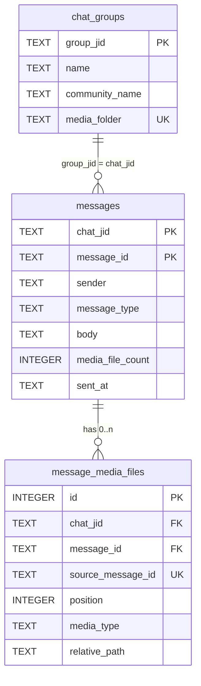
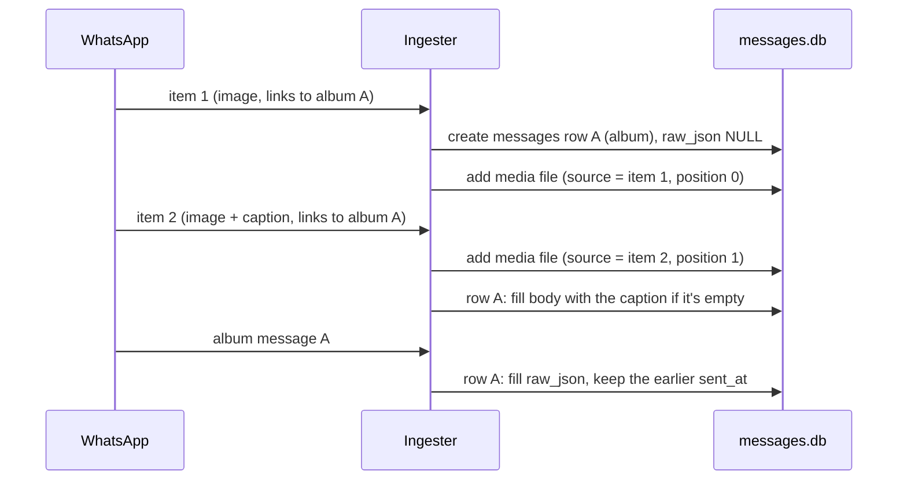
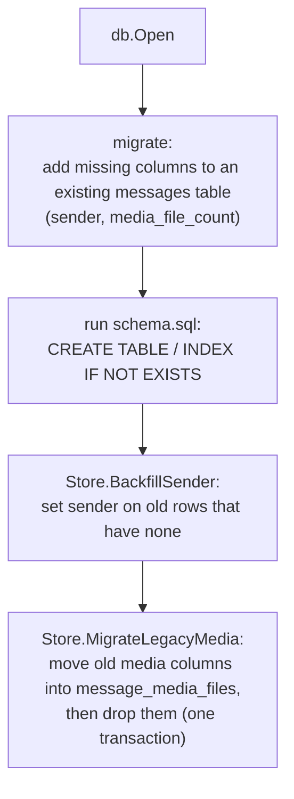

# Database

The reference for everything seth-ingestion stores: the tables and their columns, how each kind of WhatsApp message becomes rows, the rules for writing them, and how older databases are upgraded.

**On this page:** [Overview](#overview) · [Conventions](#conventions) · [Tables](#tables) · [Message types](#message-types) · [Albums](#albums) · [Write rules](#write-rules) · [Media files on disk](#media-files-on-disk) · [Example queries](#example-queries) · [Upgrades](#schema-creation-and-upgrades)

> [!TIP]
> Building an AI agent that reads this data? Start with [CONSUMING.md](CONSUMING.md). It covers the `seth-feed` HTTP API, how to follow new messages and what you can rely on, and links back here for the details.

The source of truth is [db/schema.sql](../db/schema.sql). The write logic is in [db/db.go](../db/db.go) and `Ingester.process` in [ingest.go](../ingest.go). For setup, see the [README](../README.md); for the rest of the code, the [development guide](DEVELOPMENT.md).

## Overview

| Store | Location | Owner | Contents |
|---|---|---|---|
| Message database | `data/messages.db` (`-data-dir`) | seth-ingestion | `chat_groups`, `messages` and `message_media_files` |
| Media folder | `/Users/tnpbot/Downloads/whatsapp-poc-images` (`-media-dir`) | seth-ingestion | the downloaded files that `message_media_files` points to, in a folder per group |
| Session database | `data/whatsmeow-session.db` | whatsmeow | device keys, the login session and contact mappings |

Both databases are SQLite. The message database runs in WAL mode, so it's normal to see `messages.db-wal` and `messages.db-shm` next to it. You can read it with `sqlite3` or any SQLite viewer while the program is running.

> [!WARNING]
> Never write to `whatsmeow-session.db`. whatsmeow creates and upgrades it itself, and it holds the keys of the linked device.



Each recorded group is one row in `chat_groups`. Each WhatsApp message is **exactly one** row in `messages`, even when it has several files, and its `chat_jid` is the group it was sent in. Each downloaded file is one row in `message_media_files`, which points back to its message.

## Conventions

- **Timestamps** are RFC3339 strings in UTC, such as `2026-10-12T05:35:08Z`. They sort correctly as text, and SQLite date functions accept them: `datetime(sent_at, 'localtime')`.
- **Empty values are stored as `NULL`**, not as an empty string. The exception is `sender`, which is `NOT NULL DEFAULT ''`.
- **JIDs** are WhatsApp addresses. A group's JID looks like `120363012345678901@g.us`. A user's JID is either `<phone>@s.whatsapp.net` or an opaque LID such as `216865834029298@lid`. WhatsApp is moving to LIDs, so don't parse phone numbers out of JIDs. Use `sender_phone`.
- **Message IDs** are WhatsApp's own IDs, such as `3A37298F72373DFA1114`. They are unique within a chat, which is why keys always pair them with `chat_jid`.

## Tables

### `chat_groups`

One row per monitored group: the groups of the community that `groups.txt` lists and that were found when the program started. A row is written the first time a group is found, and updated on each start and when the group is renamed. Rows are never deleted, so a group removed from `groups.txt` keeps its row and its messages.

| Column | Type | Null? | Description |
|---|---|---|---|
| `group_jid` | TEXT | no | The group's JID. **Primary key**. `messages.chat_jid` holds the same value |
| `name` | TEXT | no | The group's current name, as WhatsApp shows it. The community's announcement group is always `Announcements` |
| `community_jid` | TEXT | yes | The JID of the community the group belongs to |
| `community_name` | TEXT | yes | The community's name, e.g. `Seth` |
| `is_announcement` | INTEGER | no | `1` for the community's announcement group, otherwise `0` |
| `media_folder` | TEXT | no | The group's folder within the media folder, e.g. `cleanup-duties-campus-security`. Made from the name when the group is first recorded, and kept if the group is renamed. **Unique**, compared without case. See [Media files on disk](#media-files-on-disk) |
| `first_seen_at` | TEXT | no | When the group was first recorded |
| `updated_at` | TEXT | no | When the row was last written |

To get a message's group, join on `chat_groups.group_jid = messages.chat_jid`. There's no foreign key, because rows from the earlier single-contact version have a contact's JID in `chat_jid`.

### `messages`

One row per WhatsApp message in a monitored group. Your own messages are recorded the same way as everyone else's.

Like every ordinary SQLite table, `messages` also has a built-in `rowid`. Each new message gets the next one, and since rows are never deleted, it only grows. That makes it the cursor for following new messages; see [CONSUMING.md](CONSUMING.md#following-new-messages).

| Column | Type | Null? | Description |
|---|---|---|---|
| `chat_jid` | TEXT | no | The group the message was sent in (`…@g.us`); joins to `chat_groups.group_jid`. On rows from the earlier single-contact version, the contact's JID. **Primary key**, with `message_id` |
| `message_id` | TEXT | no | WhatsApp message ID. **Primary key**, with `chat_jid`. For an album, this is the album's own message ID |
| `sender` | TEXT | no | The sender as WhatsApp labels them in the group, at the time of the message: your saved contact name for them, otherwise the name they set for themselves, otherwise `+<phone>`. It can change over time, so group by `sender_phone` or `sender_jid` to find one person's messages. Rows from the earlier single-contact version have the configured contact name |
| `sender_jid` | TEXT | no | The sender's JID as WhatsApp sent it. May be a phone JID or a LID |
| `sender_phone` | TEXT | yes | The sender's phone number in international format, digits only, e.g. `14125778174`. Resolved from a LID when needed |
| `sender_name` | TEXT | yes | The display name the sender has set for themselves in WhatsApp, at the time of the message. Can be missing on messages from history |
| `is_group` | INTEGER | no | `1` for group messages. `0` on rows from the earlier single-contact version |
| `sent_at` | TEXT | no | When WhatsApp says the message was sent. For an album, the earliest time seen across the album and its items |
| `ingested_at` | TEXT | no | When seth-ingestion first wrote the row |
| `message_type` | TEXT | no | What kind of message this is. See [Message types](#message-types) |
| `body` | TEXT | yes | The text of a `text` or `edit` message, or the caption of a media message. For an album, the first caption received from any of its items |
| `edit_target_id` | TEXT | yes | For `edit` rows only: the ID of the message that was edited |
| `quoted_id` | TEXT | yes | If this message is a reply, the ID of the message it replies to |
| `media_file_count` | INTEGER | no | How many `message_media_files` rows belong to this message. `0` for messages without files |
| `source` | TEXT | no | `live` if received while running, or `history` if it came from the chat history WhatsApp sends after linking |
| `raw_json` | TEXT | yes | The full WhatsApp message as protobuf JSON. Used to re-process messages, and to read fields that have no column of their own. `NULL` only for an album whose album message hasn't arrived yet |

**Indexes**

| Index | Columns | Used for |
|---|---|---|
| primary key | `chat_jid, message_id` | looking up a message; preventing duplicates |
| `idx_messages_sent_at` | `sent_at` | listing messages by time |
| `idx_messages_chat_sent_at` | `chat_jid, sent_at` | one group's messages by time |
| `idx_messages_sender` | `sender, sent_at` | messages by sender name, by time |
| `idx_messages_sender_phone` | `sender_phone, sent_at` | one person's messages by time, by phone number |

### `message_media_files`

One row per media file that a message carried, whether or not the download worked.

| Column | Type | Null? | Description |
|---|---|---|---|
| `id` | INTEGER | no | Row ID. **Primary key**. Each new file gets the next one, so it's also the cursor for following new files |
| `chat_jid` | TEXT | no | **Foreign key**, with `message_id`, to the `messages` row this file belongs to |
| `message_id` | TEXT | no | The `messages` row this file is listed under. For an album item, this is the album's ID. See [`message_id` vs `source_message_id`](#message_id-vs-source_message_id) |
| `source_message_id` | TEXT | no | The ID of the WhatsApp message that delivered this file. Usually the same as `message_id`. For an album item, it's that item's own ID. **Unique**, with `chat_jid`. See [`message_id` vs `source_message_id`](#message_id-vs-source_message_id) |
| `position` | INTEGER | no | Order within an album, starting from 0. Always `0` for single-file messages |
| `media_type` | TEXT | no | `image`, `video`, `audio`, `voice` (a recorded voice note), `document` or `sticker` |
| `caption` | TEXT | yes | This file's own caption |
| `file_name` | TEXT | yes | The original file name. Only documents have one |
| `relative_path` | TEXT | yes | Where the file was saved, relative to the media folder, always with `/` separators, e.g. `preschool/20261012T053508Z_3A37298F72373DFA1114.jpg`. Starts with the group's `media_folder`. `NULL` if the download failed |
| `mime` | TEXT | yes | MIME type as reported by WhatsApp, e.g. `image/jpeg` or `audio/ogg; codecs=opus` |
| `size` | INTEGER | yes | File size in bytes |
| `sha256` | TEXT | yes | Hex SHA-256 of the saved file. The same picture sent twice has the same value |
| `error` | TEXT | yes | Why the download or save failed. `NULL` when the file was saved |
| `ingested_at` | TEXT | no | When the row was written |

**Keys and indexes**

- **Foreign key** `(chat_jid, message_id)` → `messages (chat_jid, message_id)`, with `ON DELETE CASCADE`. Deleting a message deletes its media file rows. **It does not delete the files on disk.** Foreign keys are enforced, because the program opens the database with `_foreign_keys=on`.
- **Unique** `(chat_jid, source_message_id)`, so a file delivered by one WhatsApp message can't be recorded twice.
- `idx_media_files_message` on `(chat_jid, message_id, position)`, for listing a message's files in order.

The reference sits on the media file side because one message can have many files. `messages.media_file_count` lets you find messages with files without a join.

### `message_id` vs `source_message_id`

WhatsApp delivers each file in its own message, with its own ID. Most of the time, that message is also the one we store, so both columns hold the same ID. Albums are the exception. An album arrives as one album message plus one message per photo, but we store the album as a single `messages` row. So for album photos the two columns differ:

- **`message_id`**: the `messages` row the file is listed under. For album photos, this is the album's ID.
- **`source_message_id`**: the WhatsApp message that delivered the file. For album photos, this is the photo's own ID.

For example, someone sends one photo (message `P1`), then later an album of two photos (album message `A`, delivered as photo messages `A1` and `A2`):

| `messages.message_id` | `message_type` | `message_media_files` rows (`message_id`, `source_message_id`, `position`) |
|---|---|---|
| `P1` | `image` | (`P1`, `P1`, 0) |
| `A` | `album` | (`A`, `A1`, 0) and (`A`, `A2`, 1) |

Use `message_id` to find a message's files: join on `(chat_jid, message_id)`. `source_message_id` is for recognizing a file that was already stored. Every file has its own delivering message, so a `source_message_id` identifies one file. When WhatsApp sends the same message again, for example in history sync, the program sees that `source_message_id` is already stored and skips it. It also lets you match a file to the original WhatsApp message, for example to find a reply that quotes one photo from an album.

## Message types

`Ingester.process` decides the `message_type`, and which media file rows to write, in this order:

| WhatsApp message | `message_type` | Media file rows |
|---|---|---|
| An edit (a `ProtocolMessage` of type `MESSAGE_EDIT`) | `edit`. `body` holds the new text, and `edit_target_id` points to the original message | none |
| An album message (`AlbumMessage`) | `album` | none by itself. Its items add them |
| A media message that is an item of an album | none of its own. The item is added to the album's row | one, with `position` set to the item's place in the album |
| Any other image, video, audio, voice note, document or sticker | `image`, `video`, `audio`, `voice`, `document` or `sticker` | one |
| Text, including replies (`Conversation` or `ExtendedTextMessage`) | `text` | none |
| Anything else, such as reactions, locations, contacts or polls | `other`. The content is only in `raw_json` | none |

View-once and disappearing messages are stored like ordinary ones. whatsmeow unwraps them before they reach the program.

**Edits** are stored as separate `edit` rows, and the original message's row is left unchanged. To get the latest text of a message, look for the newest `edit` row whose `edit_target_id` is that message's ID.

**Not stored:** messages in groups that aren't monitored, direct chats, status updates, broadcast lists and newsletters. The program filters these out before anything is written. Notices in a group's history with no message content, such as "… joined from the community", are skipped too.

## HD photos and videos

When someone sends a photo or video with "HD quality", WhatsApp delivers two messages: a low-resolution one (paired media type `SD_IMAGE_PARENT` or `SD_VIDEO_PARENT`) and, a moment later, the HD one. The HD message's `messageAssociation` (`HD_IMAGE_DUAL_UPLOAD` or `HD_VIDEO_DUAL_UPLOAD`) names the low-resolution message as its parent. History sync may deliver them in either order.

Only the HD file is kept. It takes the place of the low-resolution file: the same `messages` row, `position` and `source_message_id` (the low-resolution message's ID), with the HD file's path, size and hash. The HD message gets no row of its own. If the HD file can't be downloaded, the low-resolution file stays. If the low-resolution message isn't stored at all, the HD message is stored like any other media message. Startup also merges pairs left by older versions, and deletes the low-resolution files.

Motion photos and HEVC/AV1 video pairs are different content, so both of those files are kept.

## Albums

When several photos or videos are sent together, WhatsApp shows them as an album. On the wire, an album is:

1. one **album message**, which has no files, only the expected number of images and videos;
2. one **ordinary media message per item**. Each item is linked to the album's message ID and has an index within the album.

The program stores the whole album as **one** `messages` row with `message_type = 'album'`, under the album's message ID. Each item becomes a `message_media_files` row with `message_id` set to the album's ID and `source_message_id` set to the item's own ID.

The items and the album message can arrive in any order:



If the album message arrives first, it creates the row and the items just add files to it. Either way, the result is one row with `media_file_count` equal to the number of items received.

> [!NOTE]
> The album handling is based on WhatsApp's message definitions and is covered by unit tests. It hasn't yet been checked against a real album sent from a phone.

## Write rules

All writes go through `Store.Save` (in [db/db.go](../db/db.go)). It writes one message row and its media file rows **in a single transaction**, so a message never appears without its file rows, or the other way round.

**Message row.** Save inserts the row. If a row with the same `(chat_jid, message_id)` already exists, Save keeps it and only fills gaps:

| Column | When the row already exists |
|---|---|
| `body` | set only if it's currently `NULL` |
| `raw_json` | set only if it's currently `NULL` |
| `sent_at` | replaced by the new value if that's earlier |
| everything else | unchanged |

This happens when an album's items arrive before the album message, and when history sync repeats a message the program already has.

**Media file rows.** Save inserts each file, and skips any file whose `(chat_jid, source_message_id)` is already stored. It then recomputes `media_file_count` from the actual rows.

**Avoiding repeat downloads.** Before downloading anything, the program checks whether that file's `source_message_id` is already stored, using `Store.MediaFileExists`. If it is, the message is skipped. That's why messages repeated by history sync aren't downloaded twice.

**Failed downloads.** WhatsApp keeps media on its servers for a limited time, so a download can fail, especially for older history. The media file row is still written with `error` set and `relative_path`, `size` and `sha256` left `NULL`. The program doesn't retry these.

## Media files on disk

- Every file goes into its group's folder within the media folder: `<media_folder>/<sent time, UTC>_<source message id><extension>`, for example `preschool/20261012T053508Z_3A37298F72373DFA1114.jpg`.
- A group's folder name is made from the group's name when it's first recorded: lowercase letters and digits, with a dash in place of each run of spaces and other characters. Dots and apostrophes are dropped. So `Cleanup Duties/Campus Security` gets `cleanup-duties-campus-security`, `Preschool P.E. Teachers` gets `preschool-pe-teachers` and `Facilities & Outdoor` gets `facilities-outdoor`. A name with no letters or digits (only emoji, say) gets the group's ID. If another group already has that folder, the new one gets `-2`, `-3`, …. The folder doesn't change when the group is renamed, and `chat_groups.media_folder` always records it.
- Files from the earlier single-contact version are at the top of the media folder, without a group folder.
- The extension comes from the document's own file name if it has one, and otherwise from the MIME type.
- To get a file's full path, join the media folder and `relative_path`. Only the relative path is stored, so the folder can move without breaking anything.
- The program creates any missing folders before saving. Paths could include more subfolders later (for example `preschool/2026/10/…`) without any schema change.
- Nothing removes files. Deleting rows from the database leaves the files on disk.

## Example queries

Run these with `sqlite3 -readonly -header -column data/messages.db "<query>"`, or from any SQLite client.

Latest messages, with their groups:

```sql
SELECT datetime(m.sent_at, 'localtime') AS sent, g.name AS grp, m.sender, m.message_type, m.body, m.media_file_count
FROM messages m
JOIN chat_groups g ON g.group_jid = m.chat_jid
ORDER BY m.sent_at DESC
LIMIT 20;
```

One group's conversation, oldest first:

```sql
SELECT datetime(m.sent_at, 'localtime') AS sent, m.sender, m.message_type, m.body
FROM messages m
JOIN chat_groups g ON g.group_jid = m.chat_jid
WHERE g.name = 'Preschool'
ORDER BY m.sent_at;
```

Messages per group:

```sql
SELECT g.name, COUNT(m.message_id) AS messages, MAX(m.sent_at) AS latest
FROM chat_groups g
LEFT JOIN messages m ON m.chat_jid = g.group_jid
GROUP BY g.group_jid
ORDER BY latest DESC;
```

Every file with its message and group, albums in order:

```sql
SELECT m.sent_at, g.name AS grp, m.message_type, f.position, f.media_type, f.relative_path, f.caption
FROM messages m
JOIN chat_groups g ON g.group_jid = m.chat_jid
JOIN message_media_files f USING (chat_jid, message_id)
ORDER BY m.sent_at DESC, f.position;
```

Albums and how many files each has:

```sql
SELECT message_id, sent_at, media_file_count, body
FROM messages
WHERE message_type = 'album'
ORDER BY sent_at DESC;
```

Downloads that failed:

```sql
SELECT message_id, source_message_id, media_type, error
FROM message_media_files
WHERE error IS NOT NULL;
```

The same file received more than once:

```sql
SELECT sha256, COUNT(*) AS copies, GROUP_CONCAT(relative_path, ', ') AS files
FROM message_media_files
WHERE sha256 IS NOT NULL
GROUP BY sha256
HAVING copies > 1;
```

Messages with their latest edit applied:

```sql
SELECT m.message_id, m.sent_at,
       COALESCE((SELECT e.body FROM messages e
                 WHERE e.chat_jid = m.chat_jid AND e.message_type = 'edit' AND e.edit_target_id = m.message_id
                 ORDER BY e.sent_at DESC LIMIT 1), m.body) AS current_body
FROM messages m
WHERE m.message_type <> 'edit'
ORDER BY m.sent_at;
```

A field without its own column, read from `raw_json` (here, a location's coordinates):

```sql
SELECT message_id,
       json_extract(raw_json, '$.locationMessage.degreesLatitude')  AS lat,
       json_extract(raw_json, '$.locationMessage.degreesLongitude') AS lng
FROM messages
WHERE message_type = 'other' AND json_extract(raw_json, '$.locationMessage') IS NOT NULL;
```

## Schema creation and upgrades

On every start, `db.Open` brings the database up to date. Nothing needs to be set up by hand.



- **`schema.sql` always describes the full current schema.** A new database is created from it directly, and an older one gets any tables and indexes it's missing, such as `chat_groups`. Every statement is `IF NOT EXISTS`, so running it again is harmless.
- **`migrate` runs before `schema.sql`.** An index in `schema.sql` may refer to a column that an older table doesn't have yet. Adding the column first lets the index be created.
- **`BackfillSender`** fills in `sender` on rows written before the column existed, with the row's `sender_name`, or else `+<sender_phone>`, or else `sender_jid`.
- **`MigrateLegacyMedia`** upgrades databases from versions that stored at most one image per message directly on `messages`, in the columns `media_path`, `image_relative_path`, `media_mime`, `media_size`, `media_sha256` and `media_error`. It copies each image into `message_media_files`, drops those columns and recomputes `media_file_count`, all in one transaction. It needs the media folder to work out relative paths, so `main.go` calls it after `Open`. Once the old columns are gone it does nothing.

### Changing the schema

- **Adding a column:** add it to the `CREATE TABLE` in `schema.sql`. Then add an `ALTER TABLE … ADD COLUMN` step for it to `migrate` in [db/db.go](../db/db.go), so existing databases get it too. SQLite only allows `NOT NULL` on an added column if it has a default. If existing rows need a real value, backfill them after opening, the way `BackfillSender` is called from `main.go`.
- **Restructuring:** follow `MigrateLegacyMedia`. Detect the old shape from `pragma_table_info`, copy the data, then `DROP COLUMN`, all inside one transaction. `DROP COLUMN` needs SQLite 3.35 or later, and the bundled SQLite is 3.53. If several of these build up, switch to `PRAGMA user_version` with numbered steps.
- **Tests:** add a case to [db/db_test.go](../db/db_test.go) that creates a database in the old shape and checks the result, as `TestMigrateLegacyMedia` does.
