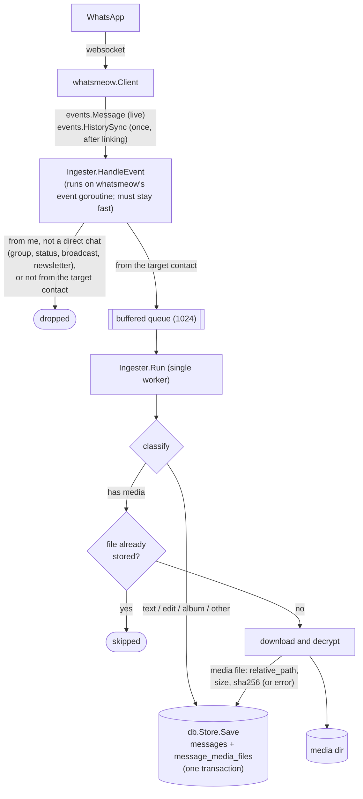
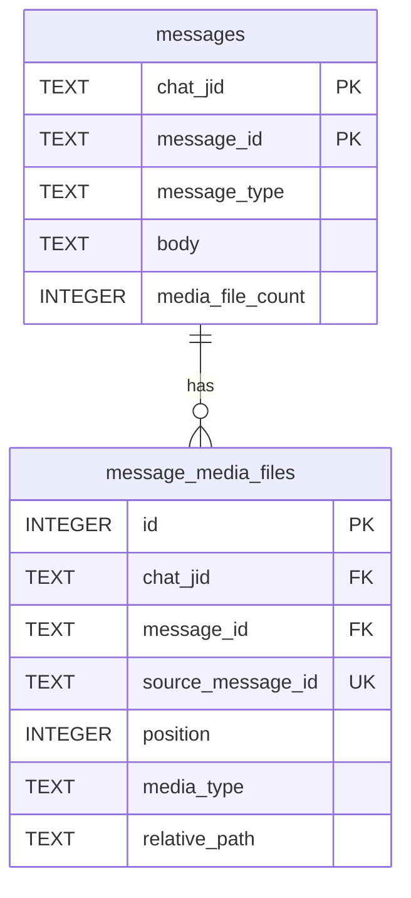

# Development guide

This guide covers how seth-ingestion is built and how to change it. For setup and usage, see the [README](../README.md).

## Layout

```
main.go          flags/env config, opening the stores, QR login, signal handling
ingest.go        event handling: filtering by contact, parsing messages, downloading media
db/schema.sql    message table DDL (embedded into the binary and applied on startup)
db/db.go         SQLite access for the message store, plus migrations from older schemas
db/db_test.go    tests for album grouping and the legacy media migration
run.sh           entry script: rebuilds when sources change, then runs bin/seth-ingestion
data/            runtime state (git-ignored)
  whatsmeow-session.db   whatsmeow's device keys and session, managed by whatsmeow
  messages.db            our ingested messages
```

## How it works



- **Why a worker queue?** whatsmeow dispatches events one at a time. A slow media download inside the handler would hold up all other events, including the session's own housekeeping. The single worker also keeps rows in arrival order.
- **Idempotency.** `messages` is keyed on `(chat_jid, message_id)` and `message_media_files` is unique on `(chat_jid, source_message_id)`. A repeated message never creates a second row. Before downloading, the worker checks `MediaFileExists`, so a history sync that repeats messages doesn't fetch their files again.
- **Sessions and logout.** `run` loops over `runSession`. Each session gets its own `whatsmeow.Client` and `Ingester`. When WhatsApp sends `events.LoggedOut` (the device was removed on the phone, or the session was revoked), whatsmeow deletes the device from the session store. `runSession` then returns `relink = true`. The loop calls `GetFirstDevice` again, gets a fresh device, and `login` shows a new QR code. `events.StreamReplaced` (a second instance using the same session) ends the program with an error. The "Monitoring…" log line is written on `events.Connected`, so it only appears once the session is accepted.
- **Shutdown.** On Ctrl+C or SIGTERM, the client disconnects first, then `Ingester.Stop` closes the queue and waits for the worker to finish what's left. Deferred calls run in reverse order: `Disconnect`, then `Stop`, then `store.Close`.

### Contact matching (phone numbers vs LIDs)

WhatsApp is moving users from phone-number JIDs (`14125778174@s.whatsapp.net`) to opaque *LIDs* (`123456789@lid`). A message's sender can come in either form. `Ingester.targetSender` checks both `Info.Sender` and `Info.SenderAlt`, and resolves LIDs to phone numbers with `client.Store.LIDs.GetPNForLID`. whatsmeow fills that mapping as it sees traffic and history. If a message from the contact is missed, a missing LID mapping is the first thing to check.

`sender_jid` stores whatever WhatsApp sent, which may be a LID. `sender_phone` stores the resolved phone number.

### Direct chats only

`isDirectChat` accepts a chat only if its JID is on the user server (`@s.whatsapp.net`) or the LID server (`@lid`). That excludes groups (`@g.us`), status updates and broadcast lists (`@broadcast`), and newsletters. `enqueue` also checks `Info.IsGroup`, and history sync skips whole non-direct conversations before parsing them.

### The `sender` column

`sender` holds the monitored contact's configured name (`-contact-name`), not anything WhatsApp sends. It's a stable label for grouping rows by contact, and it's ready for monitoring more than one contact later. To do that, replace `targetPhone`/`targetName` with a phone→name map and have `targetSender` return the matching name. `sender_name` is different: it's the push name the contact has set for themselves in WhatsApp, and it can change over time.

### Message classification

The logic is in `Ingester.process`. whatsmeow has already unwrapped ephemeral, view-once and similar wrappers, so `evt.Message` is the inner message. The exception is `AssociatedChildMessage`, which wraps album items; `process` unwraps that itself.

| Condition | `message_type` | Media files |
|---|---|---|
| `ProtocolMessage` of type `MESSAGE_EDIT` | `edit` (`body` holds the new text, `edit_target_id` the original ID) | none |
| `AlbumMessage` | `album` | none on this message; its items add them (see below) |
| media message (see `mediaOf`) that is an album item | `album`, under the **album's** message ID | one, with `position` = index in the album |
| other media message | `image`, `video`, `audio`, `voice`, `document` or `sticker` | one |
| `Conversation` or `ExtendedTextMessage` | `text` | none |
| anything else | `other` | none |

Every `messages` row also stores the full message as protobuf JSON in `raw_json`. New types can then be supported by backfilling from the database, with no need to receive the messages again.

### Messages and media files

Every WhatsApp message gets exactly one `messages` row. Every media file gets a row in `message_media_files`, which points back to its message through `(chat_jid, message_id)`. The foreign key uses `ON DELETE CASCADE`, so deleting a message deletes its media file rows, but not the files on disk. The reference sits on the media file side because a message can have many files. `messages.media_file_count` is kept up to date by `Store.Save`, so you can filter messages with files without a join.



**Albums.** WhatsApp sends an album as one `AlbumMessage`, which has no files, plus one ordinary media message per item. Each item carries a `MessageAssociation` of type `MEDIA_ALBUM` that points at the album's message ID. `albumParent` reads that association, and the item's file is saved as a media file of the album's row, never as a row of its own. `source_message_id` keeps the item's own WhatsApp ID, which is what makes re-synced items detectable. Items can arrive before the album message. In that case the first item creates the album's row. When the album message arrives later, `Save` fills in its `raw_json` and the earlier `sent_at`, and `body` takes the first caption seen. The album logic is based on the protocol definitions and the unit tests; it hasn't yet been checked against a real album sent from a phone.

**Files.** All media goes into the media dir (`-media-dir`), named `<UTC time>_<source message id><ext>`. `relative_path` is relative to that dir and always `/`-separated. `saveMedia` creates parent directories, so files can go into subdirectories (for example `2026/10/…`) just by changing how `rel` is built. When a download fails, the media file row is still written with `error` set, and the file isn't retried.

To support another media type, add a case to `mediaOf`. Any message type with media implements `whatsmeow.DownloadableMessage`.

## Database

`db/schema.sql` is embedded with `//go:embed` and run on every startup. It uses only `CREATE … IF NOT EXISTS`, so it is safe to re-run. It always describes the full current schema, so fresh databases come straight from it. Databases created by older versions are brought up to date in two steps. First, `migrate` in `db/db.go` runs before `schema.sql` and adds new columns. That ordering is needed because `schema.sql`'s indexes may reference them. Second, `main.go` calls `Store.MigrateLegacyMedia`, which moves media from the old `media_*` columns on `messages` into `message_media_files` and drops those columns, all in one transaction. It needs the media dir to work out relative paths, which is why it isn't part of `Open`. To change the schema:

- **Adding a column:** add it to the `CREATE TABLE` in `schema.sql`, and add an `if !cols["…"] { ALTER TABLE messages ADD COLUMN … }` step to `migrate`. `sender` is the example to follow. SQLite only allows `NOT NULL` on an added column if it has a default. If existing rows need a real value, backfill them after opening, the way `BackfillSender` is called from `main.go`.
- **Restructuring:** follow `MigrateLegacyMedia`. Detect the old shape from `pragma_table_info`, copy the data, then `DROP COLUMN` (SQLite 3.35+, and mattn/go-sqlite3 bundles 3.53), all inside one transaction. If several of these build up, switch to `PRAGMA user_version` with numbered steps.

The session database belongs to whatsmeow, and `sqlstore` upgrades it on its own. Don't write to it.

Timestamps are stored as RFC3339 UTC strings, so they sort correctly as text.

## Building and checking

```bash
go build -o bin/seth-ingestion .   # what run.sh does (needs CGO for mattn/go-sqlite3)
go test ./...
go vet ./...
gofmt -l .                          # should print nothing
```

`db/db_test.go` covers how albums are stored as one message (including items arriving before the album message, and duplicates) and the legacy media migration. `Ingester.process` isn't tested yet. The next step would be to give it an `events.Message` built from a `waE2E.Message` literal, run it against a temp SQLite store, and use a fake downloader.

To test by hand, link a device with a separate `-data-dir` so the real session is left alone. Then have the contact (or yourself, temporarily using `-contact-phone` with a second account's number) send a text, an image, an album of 2–3 images, a voice note, a document, a reply, and an edit:

```bash
./run.sh -data-dir ./data-dev -media-dir /tmp/seth-images -log-level DEBUG
```

## Dependencies

| Module | Purpose |
|---|---|
| `go.mau.fi/whatsmeow` | WhatsApp multi-device protocol client |
| `github.com/mattn/go-sqlite3` | SQLite driver, for both the whatsmeow session store and our messages |
| `github.com/mdp/qrterminal/v3` | renders the login QR code in the terminal |

whatsmeow has no tagged releases, so `go.mod` pins a pseudo-version. WhatsApp changes its protocol now and then. If login or decryption starts failing, update first:

```bash
go get go.mau.fi/whatsmeow@latest && go mod tidy && go build ./...
```

## Caveats

- This is an unofficial client. WhatsApp may rate-limit or ban accounts that behave unusually. Passive reading like this is low risk, but avoid running several linked instances at once.
- A linked device is logged out if the phone doesn't come online for about 14 days.
- History sync is best-effort. How much history arrives, and whether its media can still be downloaded, is up to WhatsApp.
