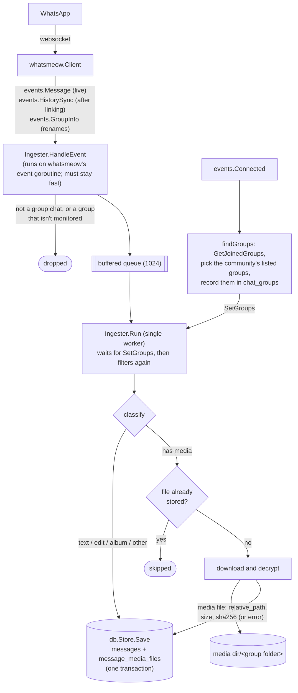

# Development guide

How seth-ingestion works inside, and how to change and test it. For setup and usage, see the [README](../README.md). For the tables and how messages become rows, see [DATABASE.md](DATABASE.md). For what downstream agents depend on, see [CONSUMING.md](CONSUMING.md).

**On this page:** [Layout](#layout) · [How it works](#how-it-works) · [Database](#database) · [Building and checking](#building-and-checking) · [Dependencies](#dependencies) · [Caveats](#caveats)

## Layout

| Path | What's there |
|---|---|
| `main.go` | Flags and environment, opening the stores, QR login, signal handling, finding the groups once connected |
| `groups.go` | Reading `groups.txt`, picking the community's listed groups, media folder names |
| `ingest.go` | Event handling: filtering by group, parsing messages, naming senders, downloading media |
| `groups.txt` | The groups to record. Read at startup, not compiled in |
| `db/schema.sql` | Table definitions, embedded into the binary and applied on startup |
| `db/db.go` | SQLite access for the message store, plus upgrades from older schemas |
| `*_test.go`, `db/db_test.go` | Tests. See [Building and checking](#building-and-checking) |
| `internal/grouplist/` | The groups-file format and the folder-name rule, shared by both programs |
| `cmd/seth-sim/` | The simulator, which writes invented group traffic to `data-sim/` for testing clients. See [CONSUMING.md](CONSUMING.md#testing-with-simulated-data) |
| `cmd/seth-feed/` | The read-only HTTP API for agents. See [CONSUMING.md](CONSUMING.md#http-api) |
| `run.sh`, `sim.sh`, `feed.sh` | Entry scripts: rebuild when sources change, then run `bin/seth-ingestion`, `bin/seth-sim` or `bin/seth-feed` |
| `docs/` | These guides, and the logo in `docs/assets/` |
| `data-sim/` | The simulator's database and media, ignored by git |
| `data/` | Runtime state, ignored by git: `messages.db` (the recorded messages) and `whatsmeow-session.db` (the linked device's keys and session, managed by whatsmeow) |

## How it works

In short: whatsmeow delivers WhatsApp events, `Ingester.HandleEvent` queues the ones that might matter, and a single worker turns them into rows and files once it knows which groups to record.



- **Why a worker queue?** whatsmeow dispatches events one at a time. A slow media download inside the handler would hold up all other events, including the session's own housekeeping. The single worker also keeps rows in arrival order.
- **Why the worker waits.** Which groups to record can only be looked up once WhatsApp has accepted the session, but history sync and live messages can arrive before that. Until `SetGroups` is called, `HandleEvent` queues every group message and every history sync, and `Run` holds them. After that, `HandleEvent` drops messages from other groups before queuing them, and the worker checks again. `Ingester.groups` is set once, before `ready` is closed, and the map isn't changed after that, so the event goroutine can read it without a lock; only the worker reads or changes the `db.Group` values in it.
- **Idempotency.** `messages` is keyed on `(chat_jid, message_id)` and `message_media_files` is unique on `(chat_jid, source_message_id)`. A repeated message never creates a second row. Before downloading, the worker checks `MediaFileExists`, so a history sync that repeats messages doesn't fetch their files again. The full write rules are in [DATABASE.md](DATABASE.md#write-rules).
- **Sessions and logout.** `run` loops over `runSession`. Each session gets its own `whatsmeow.Client` and `Ingester`. When WhatsApp sends `events.LoggedOut` (the device was removed on the phone, or the session was revoked), whatsmeow deletes the device from the session store. `runSession` then returns `relink = true`. The loop calls `GetFirstDevice` again, gets a fresh device, and `login` shows a new QR code. `events.StreamReplaced` (a second instance using the same session) ends the program with an error. The groups are looked up on the first `events.Connected` of a session; later ones (reconnects after a network drop) don't repeat it. If the lookup fails, for example because the community isn't found, the program exits with the error.
- **Shutdown.** On Ctrl+C or SIGTERM, the client disconnects first, then `Ingester.Stop` closes the queue and waits for the worker to finish what's left. If the groups were never found, the queued events are discarded. Deferred calls run in reverse order: `Disconnect`, then `Stop`, then `store.Close`.

### Finding the groups

`findGroups` (groups.go) calls `client.GetJoinedGroups`, which returns every group you're in, with community links:

- A community is a group with `IsParent`. Its groups have `LinkedParentJID` set to the community's JID.
- The community's announcement group has `IsDefaultSubGroup`. Its own name is usually the community's name, but WhatsApp shows it as "Announcements", so `selectGroups` names it `Announcements` for matching and storage.
- If a community isn't in the list itself, `findGroups` looks it up with `GetGroupInfo`, so it can still be found by name.

`selectGroups` is the pure part, and is what the tests cover. It finds the community by name (or by JID, if `-community` is one), then matches the names in `groups.txt` against the community's groups. Names are compared without case and with runs of whitespace collapsed (`nameKey`). Groups with the same name in other communities are never matched. Listed names that weren't found, and community groups that aren't listed, are returned so `findGroups` can log them.

Each selected group is recorded with `Store.SaveGroup`, which also assigns its media folder (below). `GetJoinedGroups` also stores the phone number behind each participant's LID, which helps with naming senders.

Groups are matched by name only at startup. A rename while running arrives as `events.GroupInfo` with `Name` set; `updateGroup` records the new name and keeps the group, and its folder. The announcement group's name is never updated.

### Media folders

Each group's files go in their own folder of the media dir. `mediaFolderName` makes the folder name from the group name: lowercase letters and digits, with one dash for each run of other characters, and dots and apostrophes dropped (`Preschool P.E. Teachers` → `preschool-pe-teachers`). Unicode letters are kept, and a name with no letters or digits gets the group JID's user part. `Store.SaveGroup` uses that name for a group it hasn't seen, adding `-2`, `-3`, … if another group already has the folder. `chat_groups.media_folder` compares without case, because the macOS file system does. An existing group keeps its folder, so renaming a group doesn't split its files. `mediaRelPath` builds `<folder>/<UTC time>_<message id><ext>`, which is what `message_media_files.relative_path` stores.

### Senders (phone numbers vs LIDs)

WhatsApp is moving users from phone-number JIDs (`14125778174@s.whatsapp.net`) to opaque *LIDs* (`123456789@lid`), and many groups address members by LID. `Ingester.senderPhone` checks both `Info.Sender` and `Info.SenderAlt`, and resolves LIDs to phone numbers with `client.Store.LIDs.GetPNForLID`. whatsmeow fills that mapping as it sees traffic, history and group participant lists.

`sender_jid` stores whatever WhatsApp sent, which may be a LID. `sender_phone` stores the resolved phone number, if any.

`senderLabel` fills `sender` the way WhatsApp labels people in a group: your saved contact name (`FullName`, then `FirstName`, from whatsmeow's contact store, which is synced from your phone), otherwise their own display name (`PushName`), otherwise `+<phone>`. Your own messages go through the same steps; the only difference is that your own display name comes from the session (`Store.PushName`), because the contact store doesn't hold it. `sender_name` keeps the display name alone; see [DATABASE.md](DATABASE.md#messages).

### Groups only

`HandleEvent` only queues messages whose chat is on the group server (`@g.us`). That excludes direct chats, status updates and broadcast lists (`@broadcast`), and newsletters. History sync skips whole conversations that aren't monitored groups, and skips entries with no message content (notices such as "… joined").

### Message classification

`Ingester.process` decides each message's `message_type` and its media files. The mapping, including how albums are stored as one message, is in [DATABASE.md](DATABASE.md#message-types). Two details matter in the code:

- whatsmeow unwraps ephemeral, view-once and similar wrappers before the event arrives, so `evt.Message` is the inner message. The exception is `AssociatedChildMessage`, which wraps album items; `process` unwraps that itself.
- `mediaOf` lists the media types that are downloaded, and `albumParent` detects album items. To support another media type, add a case to `mediaOf`. Any message type with media implements `whatsmeow.DownloadableMessage`.

## Database

Schema, write rules and upgrades are documented in [DATABASE.md](DATABASE.md). When you change the schema, update `db/schema.sql`, the migration steps in `db/db.go`, and DATABASE.md together.

> [!IMPORTANT]
> AI agents read this database while the program runs, and they rely on the promises in [CONSUMING.md](CONSUMING.md#what-you-can-rely-on): rows are never deleted, keys never change, `rowid` and `id` only grow, and the schema only gains columns and tables. A change that breaks one of these needs the agents updated with it, and a note in CONSUMING.md.

## Building and checking

```bash
go build -o bin/seth-ingestion .   # what run.sh does (needs CGO for mattn/go-sqlite3)
go test ./...
go vet ./...
gofmt -l .                          # should print nothing
```

The tests don't need a WhatsApp connection:

- `groups_test.go` covers reading `groups.txt`, picking the community and its groups (`selectGroups`) and folder names.
- `ingest_test.go` runs the `Ingester` with a real `whatsmeow.Client` that never connects, backed by temporary session and message databases. It sends live messages, a history sync and a rename through `HandleEvent`, before and after `SetGroups`, and checks the rows: which groups are kept, sender names and phone numbers (including a LID and your own), and an album item whose download fails.
- `db/db_test.go` covers albums, `SaveGroup` folders, `BackfillSender` and the legacy media migration.
- `internal/grouplist` tests cover reading `groups.txt` and folder names.
- `cmd/seth-sim` tests check that simulated data is consistent (albums complete, replies and edits point at real messages, files exist where `relative_path` says), that a seed repeats exactly, and that the simulator refuses to write to a real database.

- `cmd/seth-feed` tests build a database with the `db` package, serve it with `httptest`, and check every endpoint: paging, the follow cursor (including an album photo that arrives after its message was read), edits applied and replies resolved, search, media bytes and content types, failed downloads, path traversal, `/events` only on simulated data, and that the connection can't write.

### The HTTP API

`seth-feed` opens the database with `mode=ro` and only runs `SELECT`s, through the standard library's `net/http` and the same SQLite driver. It reads the tables directly rather than going through `db.Store`, which is for writing. Queries live in `cmd/seth-feed/store.go` and handlers in `server.go`.

The follow cursor `SEQ.FILE` is the last message's `rowid` and the highest file `id` among messages up to it. `/messages/new` reads both parts of each response in one transaction, so a message or file written in between is never skipped. When you add a column, add it to `Message` or `File` and to `messageColumns`, and keep the field name the same as the column. Agents rely on the field names, so treat renaming one like renaming a column.

### The simulator

`seth-sim` writes through `db.Store`, `SaveGroup` and `grouplist.FolderName`, the same code seth-ingestion uses, so a change to how rows are written reaches the simulated data too. When you add a message type or column to the ingester, add it to `emit` in `cmd/seth-sim/simulator.go` so clients can test with it. The invented people and message text are in `cmd/seth-sim/content.go`.

Successful media downloads aren't tested, because they need WhatsApp's servers. `mediaRelPath` covers where the files go.

> [!TIP]
> To test by hand, link a device with a separate `-data-dir` so the real session is left alone. Then send a text, an image, an album of 2–3 images, a voice note, a document, a reply and an edit in one of the listed groups (a test group of your own works, if you add it to a copy of `groups.txt`), and check that a message in an unlisted group isn't recorded:
>
> ```bash
> ./run.sh -data-dir ./data-dev -media-dir /tmp/seth-media -groups-file groups-dev.txt -log-level DEBUG
> ```

## Dependencies

| Module | Purpose |
|---|---|
| `go.mau.fi/whatsmeow` | WhatsApp multi-device protocol client |
| `github.com/mattn/go-sqlite3` | SQLite driver, for both the whatsmeow session store and our messages |
| `github.com/mdp/qrterminal/v3` | renders the login QR code in the terminal |

whatsmeow has no tagged releases, so `go.mod` pins a pseudo-version. WhatsApp changes its protocol now and then. If login or decryption starts failing, update first:

```bash
go get go.mau.fi/whatsmeow@latest && go mod tidy && go build ./...
```

## Caveats

> [!WARNING]
> whatsmeow is an unofficial WhatsApp client. WhatsApp may rate-limit or ban accounts that behave unusually. Passive reading like this is low risk, but don't run several linked instances at once.

- A linked device is logged out if the phone doesn't come online for about 14 days.
- History sync is best-effort. How much history arrives, and whether its media can still be downloaded, is up to WhatsApp.
- Edits that arrive in history sync are a known gap. whatsmeow's `ParseWebMessage` gives them the ID and content of the message they edit, so they aren't stored as `edit` rows: if the original is already stored, the edit is treated as a repeat of it and dropped; otherwise it's stored as the original, with the edited text. Live edits are stored as `edit` rows.
